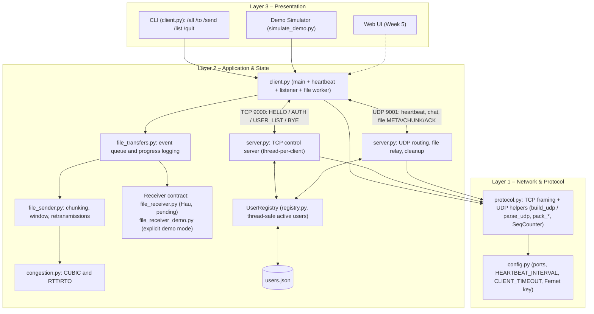
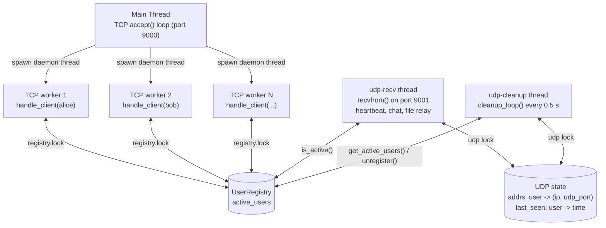
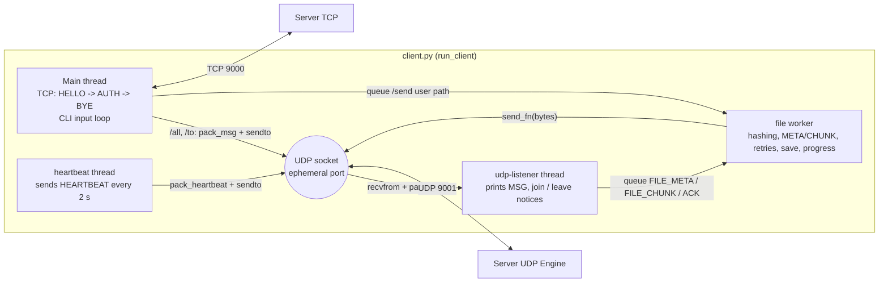
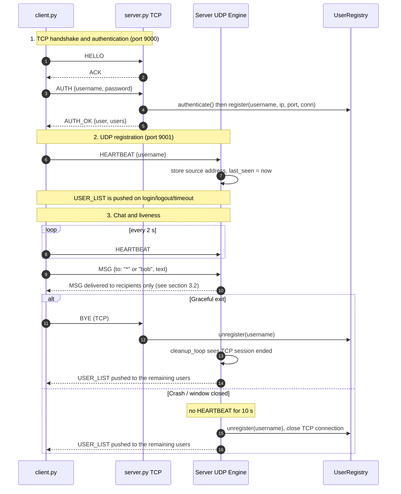
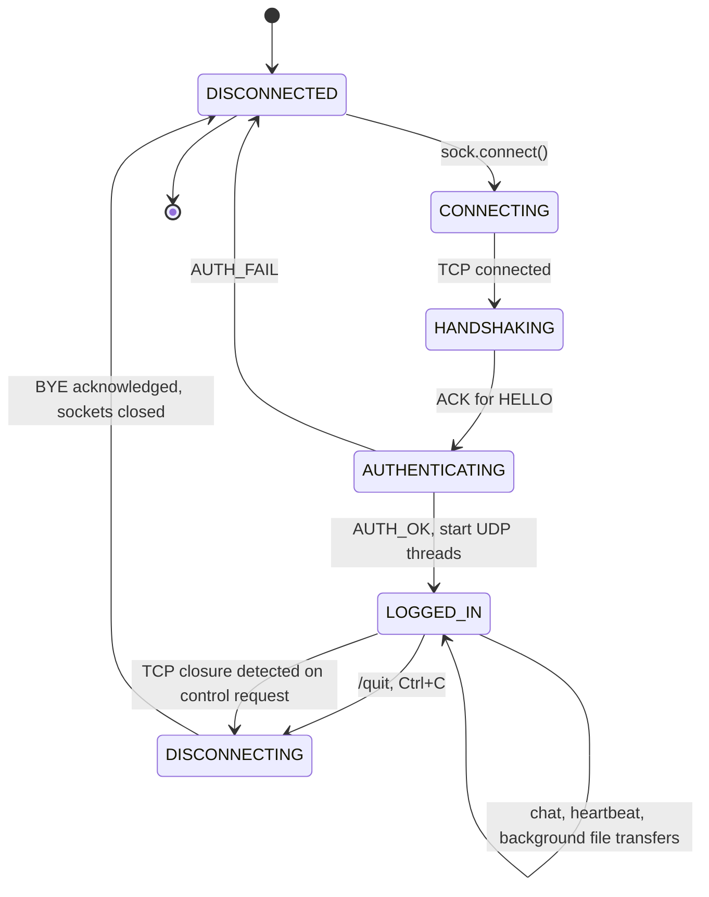

# System Architecture – Networking App Assignment

> **Scope:** Week 4 – reliable unicast UDP file transfer, alongside chat and heartbeat.
>
> Run `server.py` directly: TCP control, UDP routing, file relay and cleanup are integrated. `server_demo.py` is an older Week 3 reference and is not used for Week 4 validation.

---

## 1. Three-Layer Architecture

The system keeps network logic, state/data processing, and the user interface separate:

**Dual-channel design**

| Channel     | Port | Purpose                                                        | Framing                                                         |
| ----------- | :--: | -------------------------------------------------------------- | --------------------------------------------------------------- |
| TCP control | 9000 | Handshake, login, logout, on-demand user list                  | 4-byte length prefix + JSON                                     |
| UDP data    | 9001 | Heartbeat, chat, user lists, reliable unicast files | 37-byte header; encrypted JSON or binary chunks; empty ACK payload |

The TCP session is the source of truth for **who is logged in**. The UDP channel only carries real-time traffic for users who are already active in the registry.

---

## 2. Server Concurrency Architecture

The server uses a thread-per-client model for TCP and two dedicated daemon threads for UDP:

- **Thread isolation:** a slow or abruptly closed TCP client only affects its own worker thread.
- **UDP and TCP run independently.** The UDP loop handles `ConnectionResetError` by continuing. `stop()` closes both sockets.
- Separate locks protect the registry, UDP addresses, heartbeat timestamps and file-session table. Network sends run outside the file-session lock.

---

## 3. Server UDP Engine – Routing & Liveness Monitor

### 3.1 Responsibilities

| Component                                     | Behaviour                                                                                                                                                                                                                                            |
| --------------------------------------------- | ---------------------------------------------------------------------------------------------------------------------------------------------------------------------------------------------------------------------------------------------------- |
| UDP socket                                    | Bind `SERVER_HOST:UDP_PORT` (9001), run in parallel with the TCP listener inside `server.py`.                                                                                                                                                    |
| Receive loop                                  | `recvfrom()` -> `parse_udp()`. A datagram that fails validation is logged and ignored, never crashes the server.                                                                                                                                 |
| `HEARTBEAT` handler | Store the source UDP address and refresh `last_seen` for the supplied username. Endpoint authentication still needs hardening; see the review report. |
| `MSG` handler / `forward(sender, packet)` | Existing Week 3 routing uses the claimed `from` field. It is separate from the Week 4 file endpoint checks. |
| File handlers | Resolve registered endpoint, validate metadata and session direction; relay chunks and ACKs without buffering file data. |
| `cleanup_loop` | Every 0.5 s: remove users silent for 10 s and file sessions idle for 30 s. TCP worker cleanup handles disconnects and broadcasts `USER_LIST`. |

### 3.2 Routing rules

| `to` value                                             | Recipients                                 | Not delivered to                    |
| -------------------------------------------------------- | ------------------------------------------ | ----------------------------------- |
| `"*"` (broadcast)                                      | Every user with a known UDP address        | The sender                          |
| `"<username>"` (unicast)                               | Only that user                             | Everyone else, including the sender |
| Offline recipient | Nobody; drop and log | All users |

### 3.3 Heartbeat timeout

When a user is alive over TCP but sends no heartbeat for 10 s, the engine unregisters the user, closes the user's TCP connection (so the TCP worker thread finishes), removes the UDP state, and pushes a new `USER_LIST` to everyone left.

---

## 4. Client Architecture

`client.py` runs TCP control on the main thread and three background threads:

| CLI command           | Action                                    | Channel           |
| --------------------- | ----------------------------------------- | ----------------- |
| `/all <text>`       | Broadcast (`to = "*"`)                  | UDP               |
| `/to <user> <text>` | Private message (`to = <user>`)         | UDP               |
| `/list`             | Request the user list (with IP and port)  | TCP `USER_LIST` |
| `/send <user> <file>` | Queue a reliable unicast file transfer | UDP via file worker |
| `/quit`             | Stop threads, send `BYE`, close sockets | TCP               |

- The client binds an ephemeral UDP port and sends one `HEARTBEAT` immediately after login, before any chat message, so the server learns its UDP address.
- Incoming `USER_LIST` datagrams contain only usernames; the listener compares them with the last known set and prints `[+] name is now online` / `[-] name went offline`.
- Broadcast needs the explicit `/all` command, so a typo cannot message everyone.

---

## 5. Sequence Diagram – Session Lifecycle (TCP + UDP)

Detailed Broadcast, Unicast and Heartbeat sequence diagrams are maintained in `docs/protocol.md` (Quynh).

---

## 6. Client State Machine

## 7. Week 4 file worker and lifecycle

`FileTransfers` owns a bounded event queue and one file worker per client. `/send` queues a path immediately. The worker reads/hashes the file, constructs `FileSender`, ticks its CUBIC/RTO state, and dispatches incoming file packets to sender or receiver. The UDP listener only parses and queues file packets, so disk I/O and retransmission waits do not block incoming chat. Heartbeat remains on its own thread.

Receiver selection is explicit. Default: import Hau's `file_receiver.FileReceiver`; if it is missing, receiving is disabled while chat/sending continue. `--demo-receiver` opts into `file_receiver_demo.FileReceiver` and prints a DEMO notice. The worker uses public `on_packet`, `tick`, `is_receiving` and `close` APIs, without depending on receiver session internals. See `docs/file-receiver-handoff.md`.

`FileSender` and `FileReceiver` depend on `send_fn(bytes)`, not sockets. They can run on the production UDP socket or a seeded in-memory lossy link. Sender protects its state with an RLock. The file worker serializes receiver updates and ticks. SeqCounter is shared by heartbeat, chat and file traffic.

| State | Transition |
| --- | --- |
| Sender WAIT_META | Send FILE_META; retry on RTO; begin chunks after matching ACK |
| Sender SENDING | Up to cwnd outstanding chunks; selective ACK and retransmission |
| Sender DONE | Every chunk ACKed, including the chunk completing receiver verification/save |
| Sender FAILED | Offline notice, 30 s without new ACK, retry limit, read/network error or local exit |
| Receiver RECEIVING | Store valid chunks by index, ACK duplicates, accept reordering |
| Receiver COMPLETE | Verify SHA-256, save once, ACK completion, retain ACK tombstone 30 s |
| Receiver FAILED | Checksum/save error; no completion ACK; discard buffered bytes |

On logout the client stops the file worker before closing UDP, then sends TCP BYE. A `USER_LIST` offline notice cancels sends to that peer; if the notice is lost, the 30 s ACK inactivity limit still applies. Server closes file sessions on either peer leaving or 30 s inactivity; a successful live session otherwise expires by inactivity, since the current protocol has no FILE_DONE packet.

Bounds: at most 8 outgoing sends and 16 receiver sessions per client. Files are read/buffered in memory within the uint16 chunk limit; streaming larger files from disk is future work. Completed receiver sessions hold no chunk bytes. No claim is made here about hostile-peer authentication: the pre-existing Week 3 heartbeat/message identity checks need separate hardening.

Run the real three-client demo with `python simulate_demo.py --file-demo --demo-receiver --self-host`. This validates the sender against the reference receiver over real sockets. Hau's implementation needs its own run with the flag removed after delivery. Validation and baseline review are in `docs/reviews/week4-review.md`.
