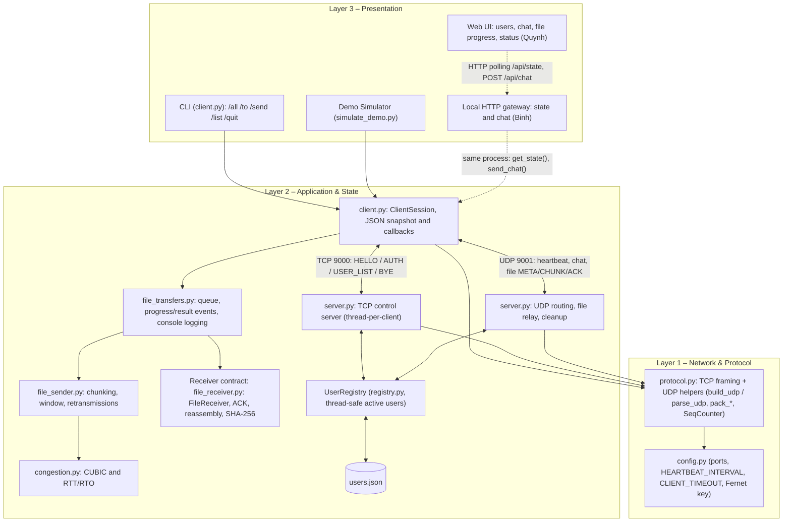
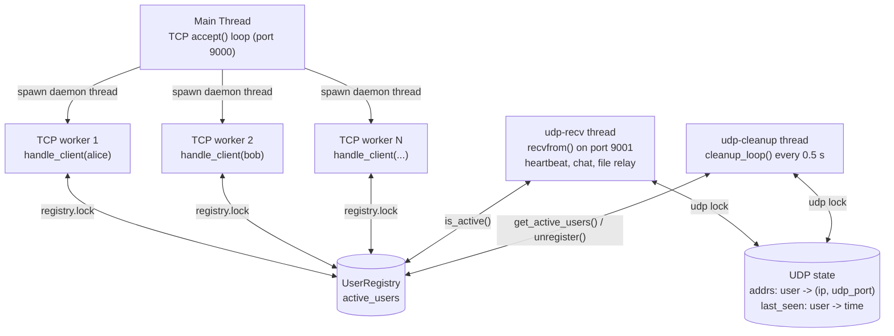
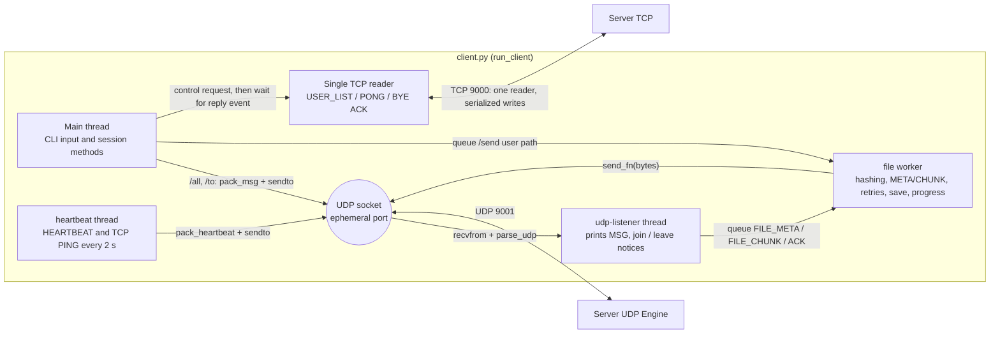
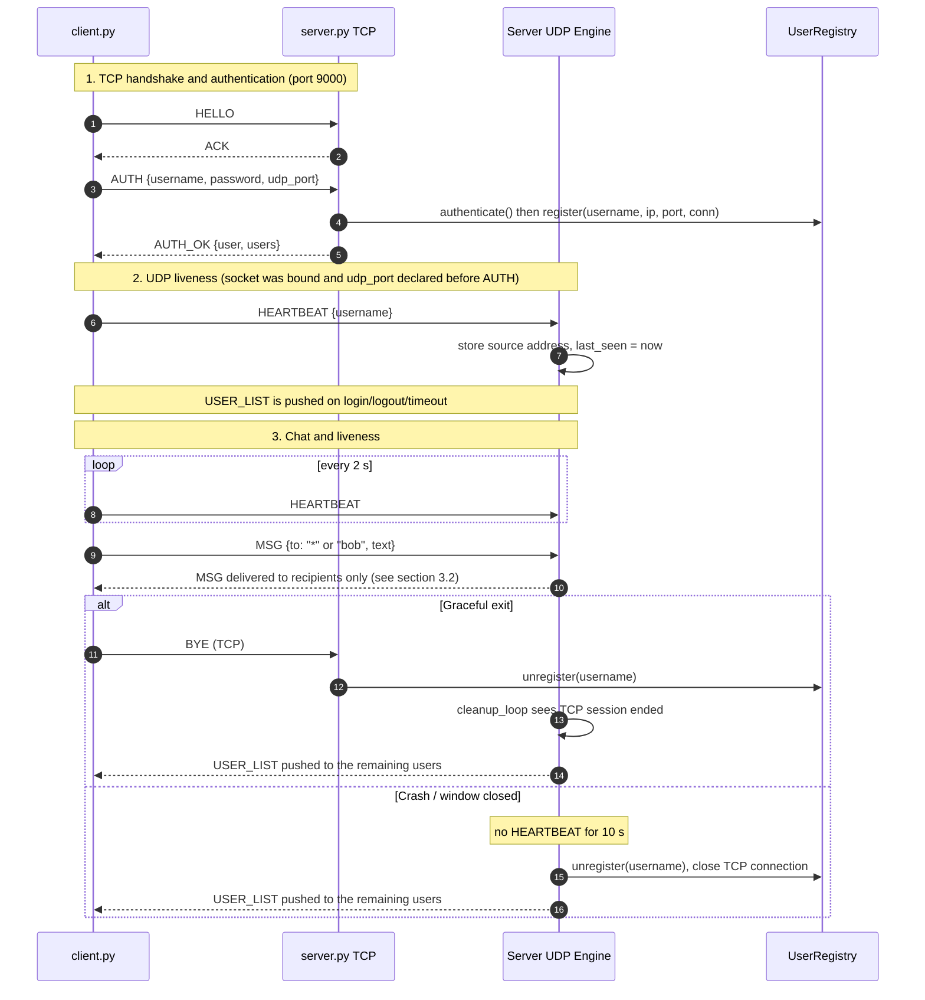
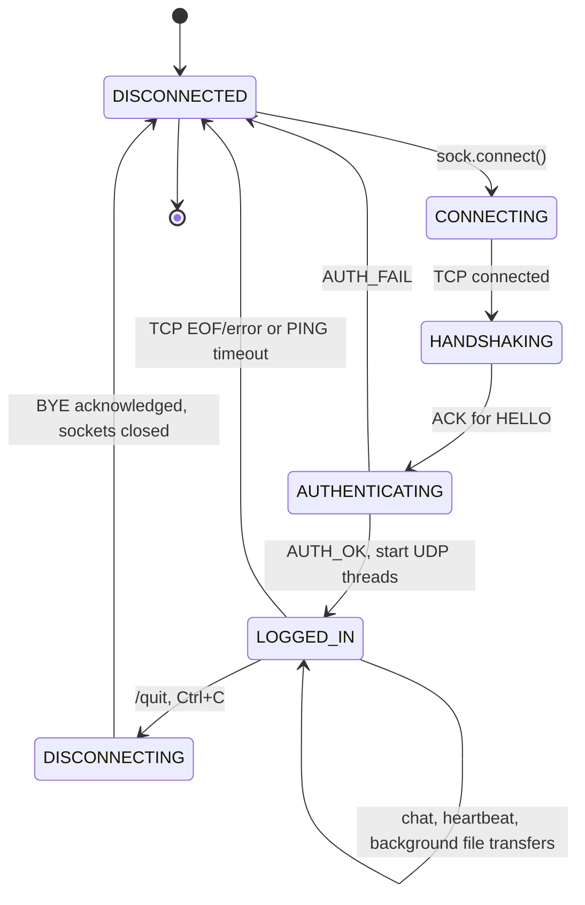

# System Architecture – Networking App Assignment

> **Scope:** Week 5 client API and UI events, built on the Week 4 UDP chat/file transport.
>
> Run `server.py` directly: TCP control, UDP routing, file relay and cleanup are integrated.
> HTTP gateway/UI are integration dependencies owned by Binh/Quynh. Their contract is defined in `docs/client_api.md`; the client already exposes the Python API and `--web-port` hook.

---

## 1. Three-Layer Architecture

The system keeps network logic, state/data processing, and the user interface separate:

| Channel     | Port | Purpose                                             | Framing                                                            |
| ----------- | :--: | --------------------------------------------------- | ------------------------------------------------------------------ |
| TCP control | 9000 | Handshake, login, logout, user list, PING/PONG | Existing protocol framing; TCP encryption is Hau's Week 5 integration |
| UDP data    | 9001 | Heartbeat, chat, user lists, reliable unicast files | 37-byte header; encrypted JSON or binary chunks; empty ACK payload |

The TCP session is the source of truth for **who is logged in**. The UDP channel only carries real-time traffic for users who are already active in the registry.

---

## 2. Server Concurrency Architecture

The server uses a thread-per-client model for TCP and two dedicated daemon threads for UDP:

- **Thread isolation:** a slow or abruptly closed TCP client only affects its own worker thread.
- **UDP and TCP run independently.** The UDP loop handles `ConnectionResetError` by continuing. `stop()` closes both sockets.
- Separate locks protect the registry, UDP addresses, heartbeat timestamps and file-session table. Network sends run outside the file-session lock.

---

## 3. Server UDP Engine – Routing & Liveness Monitor

### 3.1 Responsibilities

| Component                                     | Behaviour                                                                                                                                               |
| --------------------------------------------- | ------------------------------------------------------------------------------------------------------------------------------------------------------- |
| UDP socket                                    | Bind `SERVER_HOST:UDP_PORT` (9001), run in parallel with the TCP listener inside `server.py`.                                                       |
| Receive loop                                  | `recvfrom()` -> `parse_udp()`. A datagram that fails validation is logged and ignored, never crashes the server.                                    |
| `HEARTBEAT` handler                         | Store the source UDP address and refresh `last_seen` for the supplied username. Endpoint authentication still needs hardening; see the review report. |
| `MSG` handler / `forward(sender, packet)` | Existing Week 3 routing uses the claimed `from` field. It is separate from the Week 4 file endpoint checks.                                           |
| File handlers                                 | Resolve registered endpoint, validate metadata and session direction; relay chunks and ACKs without buffering file data.                                |
| `cleanup_loop`                              | Every 0.5 s: remove users silent for 10 s and file sessions idle for 30 s. TCP worker cleanup handles disconnects and broadcasts `USER_LIST`.         |

### 3.2 Routing rules

| `to` value               | Recipients                          | Not delivered to                    |
| -------------------------- | ----------------------------------- | ----------------------------------- |
| `"*"` (broadcast)        | Every user with a known UDP address | The sender                          |
| `"<username>"` (unicast) | Only that user                      | Everyone else, including the sender |
| Offline recipient          | Nobody; drop and log                | All users                           |

### 3.3 Heartbeat timeout

When a user is alive over TCP but sends no heartbeat for 10 s, the engine unregisters the user, closes the user's TCP connection (so the TCP worker thread finishes), removes the UDP state, and pushes a new `USER_LIST` to everyone left.

---

## 4. Client Architecture

`ClientSession.start()` performs handshake/auth, then runs one TCP reader, one UDP reader, heartbeat/PING and the file worker. The main thread runs the existing CLI; an optional local gateway gets the same session object.

| CLI command             | Action                                    | Channel             |
| ----------------------- | ----------------------------------------- | ------------------- |
| `/all <text>`         | Broadcast (`to = "*"`)                  | UDP                 |
| `/to <user> <text>`   | Private message (`to = <user>`)         | UDP                 |
| `/list`               | Request the user list (with IP and port)  | TCP `USER_LIST`   |
| `/send <user> <file>` | Queue a reliable unicast file transfer    | UDP via file worker |
| `/quit`               | Stop threads, send `BYE`, close sockets | TCP                 |

- The client binds an ephemeral UDP port before AUTH and includes `udp_port` in the authenticated request. Heartbeat continues on that same UDP socket after login. Server endpoint hardening remains Binh's integration responsibility.
- Incoming `USER_LIST` datagrams contain only usernames; the listener compares them with the last known set and prints `[+] name is now online` / `[-] name went offline`.
- Broadcast needs the explicit `/all` command, so a typo cannot message everyone.

---

## 5. Sequence Diagram – Session Lifecycle (TCP + UDP)

Detailed Broadcast, Unicast and Heartbeat sequence diagrams are maintained in `docs/protocol.md` (Quynh).

---

## 6. Client State Machine

## 7. Week 4 file worker and lifecycle

`FileTransfers` owns a bounded event queue and one file worker per client. `/send` queues a path and returns a UUID immediately. The worker reads/hashes the file, constructs `FileSender`, ticks CUBIC/RTO, and dispatches incoming file packets. The UDP listener only parses/queues file packets, keeping disk I/O and retries away from incoming chat. The worker publishes JSON progress/result records back to ClientSession.

`FileTransfers` creates `file_receiver.FileReceiver` directly and uses its public APIs `on_packet`, `tick`, `close` and `on_result`.

`FileSender` and `FileReceiver` depend on `send_fn(bytes)`, not sockets. They can run on the production UDP socket or a seeded in-memory lossy link. Sender protects its state with an RLock. The file worker serializes receiver updates/ticks and derives receive progress from accepted unique chunks plus the existing result callback, without inspecting receiver buffers. SeqCounter is shared by heartbeat, chat and file traffic.

| State              | Transition                                                                          |
| ------------------ | ----------------------------------------------------------------------------------- |
| Sender WAIT_META   | Send FILE_META; retry on RTO; begin chunks after matching ACK                       |
| Sender SENDING     | Up to cwnd outstanding chunks; selective ACK and retransmission                     |
| Sender DONE        | Every chunk ACKed, including the chunk completing receiver verification/save        |
| Sender FAILED      | Offline notice, 30 s without new ACK, retry limit, read/network error or local exit |
| Receiver RECEIVING | Store valid chunks by index, ACK duplicates, accept reordering                      |
| Receiver COMPLETE  | Verify SHA-256, save once, ACK completion, retain ACK tombstone 30 s                |
| Receiver FAILED    | Checksum/save error; no completion ACK; discard buffered bytes                      |

On logout the client requests TCP BYE, stops its workers and closes sockets. A `USER_LIST` offline notice cancels sends to that peer; if the notice is lost, the 30 s ACK inactivity limit still applies. Server closes file sessions on either peer leaving or 30 s inactivity; a successful live session otherwise expires by inactivity, since the current protocol has no FILE_DONE packet.

Bounds: at most 8 outgoing sends and 16 receiver sessions per client. Files are read/buffered in memory within the uint16 chunk limit; streaming larger files from disk is future work. Completed receiver sessions hold no chunk bytes. No claim is made here about hostile-peer authentication: the pre-existing Week 3 heartbeat/message identity checks need separate hardening.

Run the real three-client demo with `python simulate_demo.py --mode file --self-host`. This validates the sender and production receiver over real sockets.

## 8. Client state and gateway contract

`ClientSession.get_state()` takes a short state lock and returns a detached JSON-safe copy. It never reads a socket. Snapshot v1 contains status, sorted usernames, up to 100 messages and 50 transfer records. The gateway can serve this snapshot directly; frontend rendering deduplicates by message/transfer UUID. Passwords, keys and sockets are excluded.

Each file record tracks direction, peer, filename, size, acknowledged/accepted bytes, progress, terminal result and errors. Receive duplicates do not increase bytes. Progress 1.0 is reserved for successful verification/save; a failed or unverified file remains below 1.0. A missing local path is reported asynchronously as a failed transfer.

TCP requests are serialized when a caller needs a USER_LIST reply, and all replies are consumed by the control reader. The heartbeat thread only writes PING; PONG or other control replies refresh liveness. EOF, malformed control responses, socket errors or CLIENT_TIMEOUT without control traffic publish an error and stop the session. Browser HTTP availability alone says nothing about network-session health.

The optional CLI flag `--web-port` starts the raw-socket HTTP gateway (`start_gateway()`). It supports two execution modes:
1. **CLI Session Mode**: started after AUTH with `session` passed in (`python client.py alice pass123 --web-port 8080`).
2. **Web-First Mode (`--web-only`)**: started without an initial session (`python client.py --web-port 8080 --web-only`), allowing dynamic login and logout via `POST /api/login` and `POST /api/logout`.

The gateway also provides Server-Sent Events (`GET /api/events`) for 0ms latency UI updates, file upload (`POST /api/file/upload`), and file download (`GET /api/file/download/<filename>`). See `docs/client_api.md` and `docs/web_gateway.md` for complete API schemas and implementation details.
