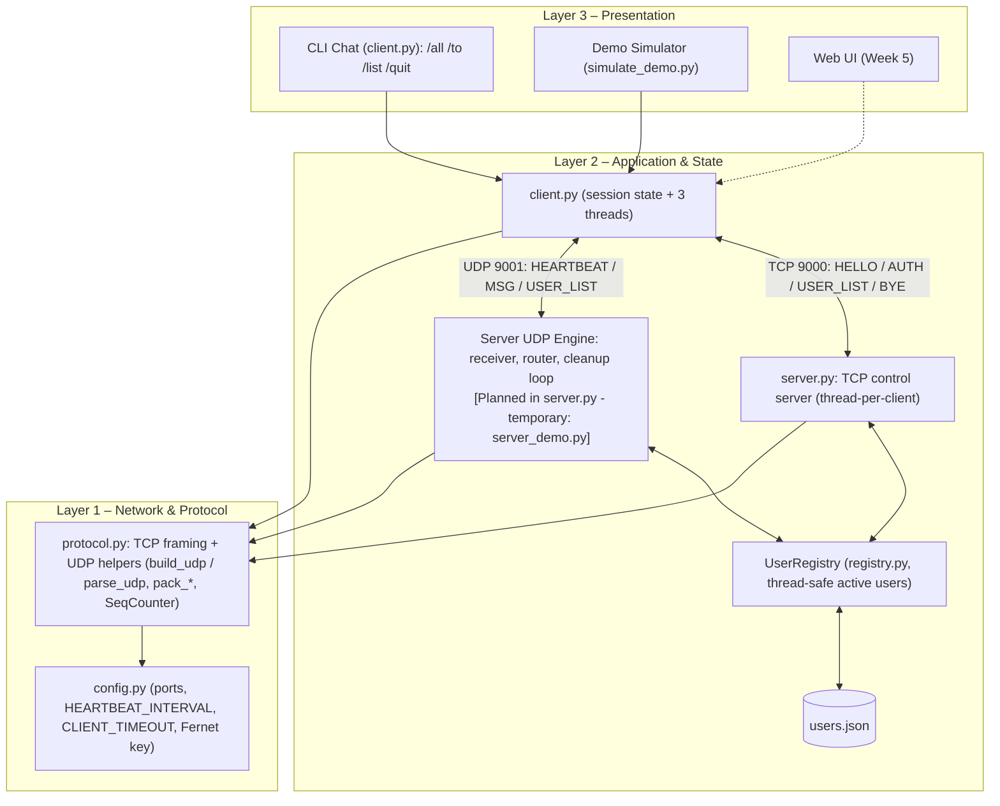
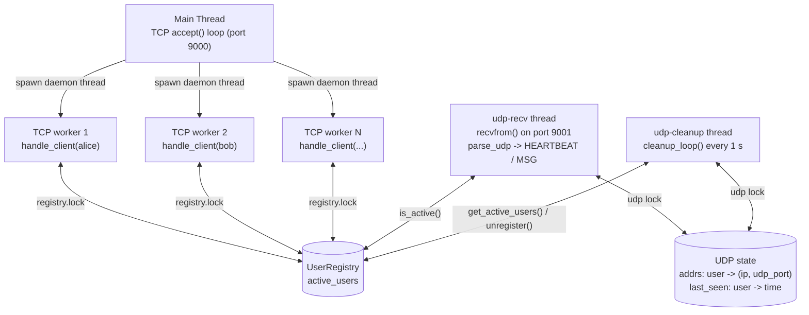
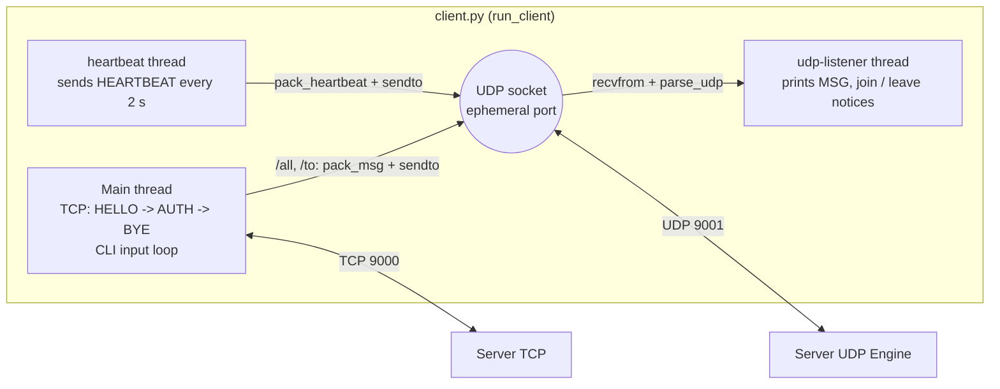
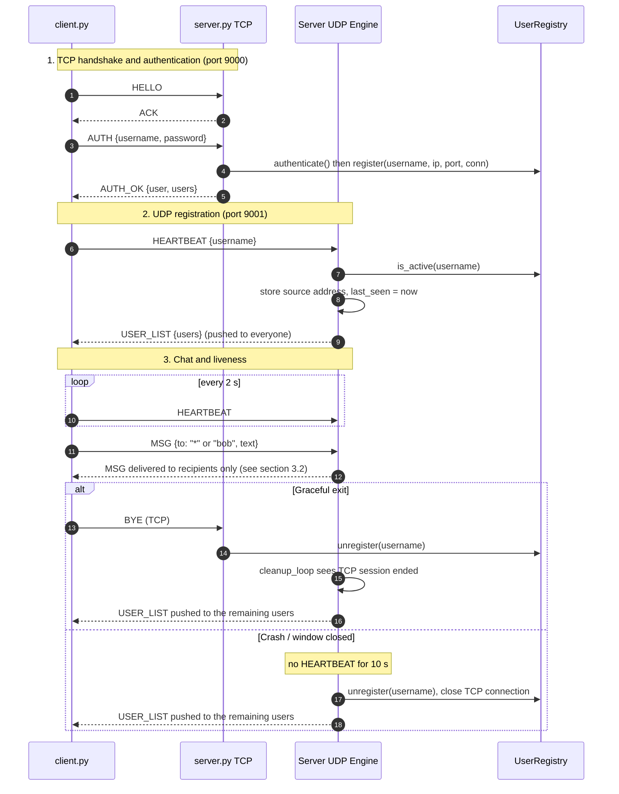
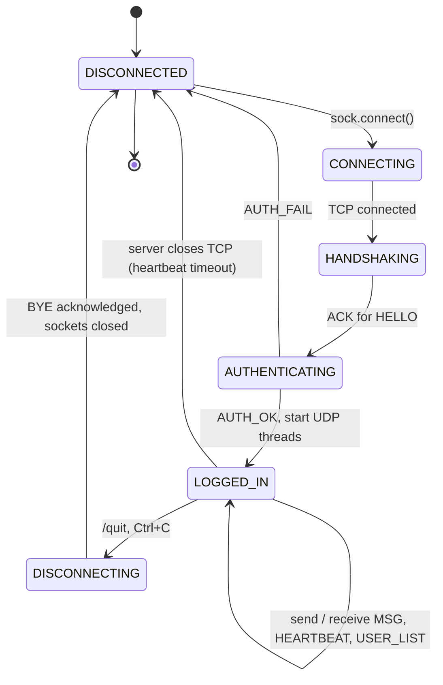

# System Architecture – Networking App Assignment

> **Scope:** Week 3 – UDP Messaging, Heartbeat & Liveness (Rubric 5), built on Week 1-2 (handshake, authentication, concurrency).
>
> **Status note:** The Server UDP Engine (routing + liveness monitor) is **not yet merged into `server.py`**. Until it is, `server_demo.py` runs the real TCP server plus a temporary UDP engine (`DemoUdpEngine`) so that `client.py` can be tested end to end. Sections marked **[Planned in server.py]** describe the target design; the demo already implements it in one process.

---

## 1. Three-Layer Architecture

The system keeps network logic, state/data processing, and the user interface separate:

**Dual-channel design**

| Channel     | Port | Purpose                                                        | Framing                                                         |
| ----------- | :--: | -------------------------------------------------------------- | --------------------------------------------------------------- |
| TCP control | 9000 | Handshake, login, logout, on-demand user list                  | 4-byte length prefix + JSON                                     |
| UDP data    | 9001 | Heartbeat, chat messages (broadcast / unicast), user-list push | One packet per datagram: 37-byte header + Fernet-encrypted JSON |

The TCP session is the source of truth for **who is logged in**. The UDP channel only carries real-time traffic for users who are already active in the registry.

---

## 2. Server Concurrency Architecture

The server uses a thread-per-client model for TCP and two dedicated daemon threads for UDP:

- **Thread isolation:** a slow or abruptly closed TCP client only affects its own worker thread.
- **UDP never blocks TCP:** the UDP receive loop uses a 0.5 s socket timeout so it can stop cleanly, and handles `ConnectionResetError` (Windows reports ICMP "port unreachable" this way) by continuing.
- **Two locks, two responsibilities:** `registry.lock` protects the active-user table; a separate lock protects the UDP address and `last_seen` maps. Threads never hold both at the same time, which avoids deadlocks.

---

## 3. Server UDP Engine – Routing & Liveness Monitor **[Planned in server.py]**

### 3.1 Responsibilities

| Component                                     | Behaviour                                                                                                                                                                                                                                            |
| --------------------------------------------- | ---------------------------------------------------------------------------------------------------------------------------------------------------------------------------------------------------------------------------------------------------- |
| UDP socket                                    | Bind `SERVER_HOST:UDP_PORT` (9001), run in parallel with the TCP listener inside `server.py`.                                                                                                                                                    |
| Receive loop                                  | `recvfrom()` -> `parse_udp()`. A datagram that fails validation is logged and ignored, never crashes the server.                                                                                                                                 |
| `HEARTBEAT` handler                         | Ignore users who are not logged in over TCP (`registry.is_active`). Otherwise store the **source address of the datagram** as the user's UDP address and refresh `last_seen`. The first heartbeat of a user triggers a `USER_LIST` push. |
| `MSG` handler / `forward(sender, packet)` | Identify the sender from the datagram's source address (the `from` field sent by the client is overwritten with the registered username). Route by `to`.                                                                                         |
| `cleanup_loop`                              | Every second: remove users whose TCP session has ended, and users with no heartbeat for `CLIENT_TIMEOUT` (10 s). Broadcast the new `USER_LIST` after every removal.                                                                              |

### 3.2 Routing rules

| `to` value                                             | Recipients                                 | Not delivered to                    |
| -------------------------------------------------------- | ------------------------------------------ | ----------------------------------- |
| `"*"` (broadcast)                                      | Every user with a known UDP address        | The sender                          |
| `"<username>"` (unicast)                               | Only that user                             | Everyone else, including the sender |
| Unknown / offline user, or sender address not registered | Nobody; the datagram is dropped and logged | –                                  |

### 3.3 Heartbeat timeout

When a user is alive over TCP but sends no heartbeat for 10 s, the engine unregisters the user, closes the user's TCP connection (so the TCP worker thread finishes), removes the UDP state, and pushes a new `USER_LIST` to everyone left.

---

## 4. Client Architecture

`client.py` runs the TCP control session on the main thread and two UDP background threads:

| CLI command           | Action                                    | Channel           |
| --------------------- | ----------------------------------------- | ----------------- |
| `/all <text>`       | Broadcast (`to = "*"`)                  | UDP               |
| `/to <user> <text>` | Private message (`to = <user>`)         | UDP               |
| `/list`             | Request the user list (with IP and port)  | TCP `USER_LIST` |
| `/quit`             | Stop threads, send `BYE`, close sockets | TCP               |

- The client binds an ephemeral UDP port and sends one `HEARTBEAT` immediately after login, before any chat message, so the server learns its UDP address.
- Incoming `USER_LIST` datagrams contain only usernames; the listener compares them with the last known set and prints `[+] name is now online` / `[-] name went offline`.
- Broadcast needs the explicit `/all` command, so a typo cannot message everyone.

---

## 5. Sequence Diagram – Session Lifecycle (TCP + UDP)

Detailed Broadcast, Unicast and Heartbeat sequence diagrams are maintained in `docs/protocol.md` (Quynh).

---

## 6. Client State Machine

