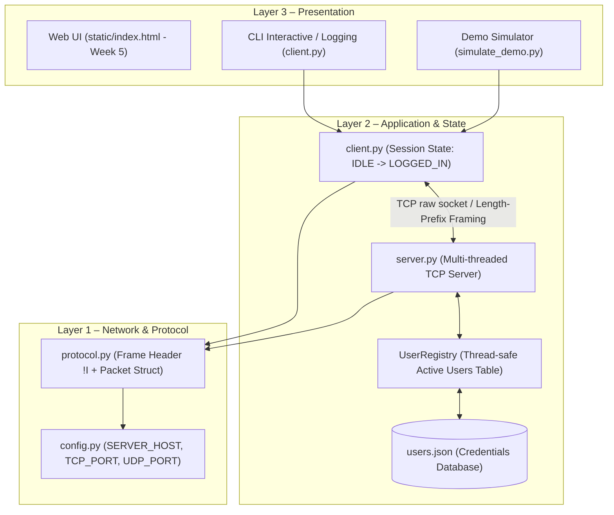
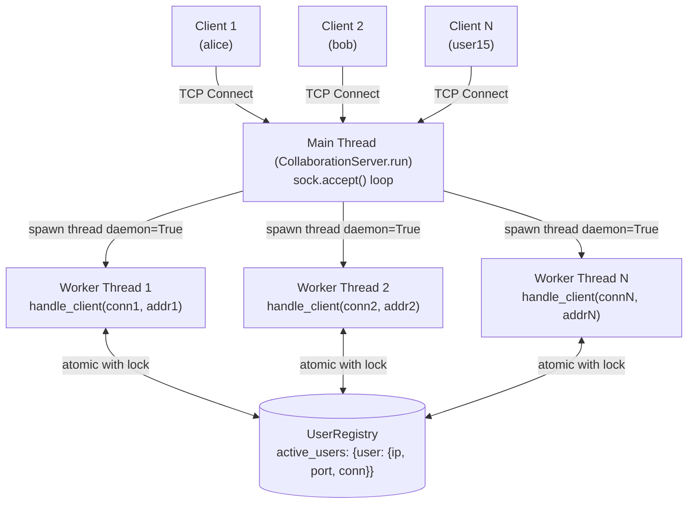
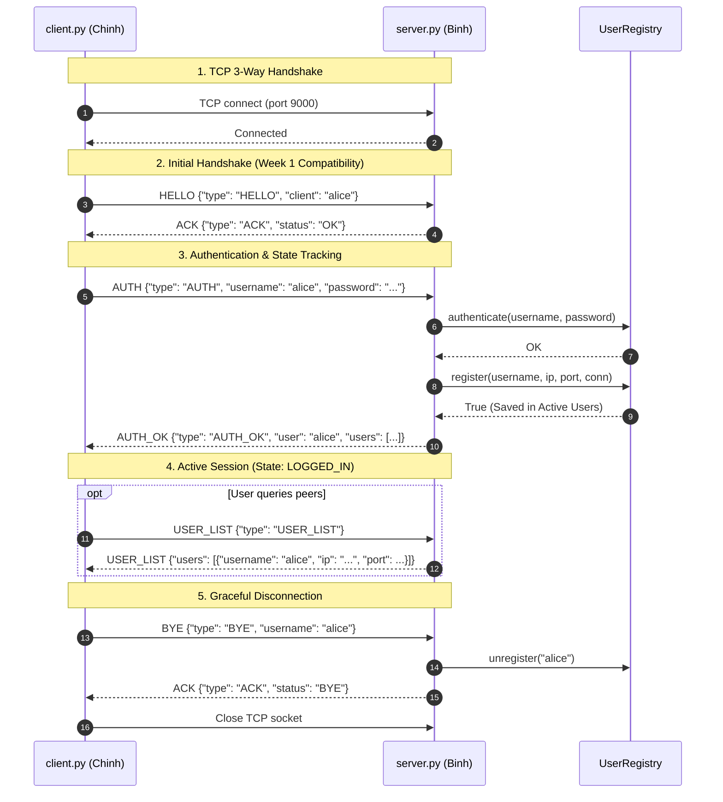
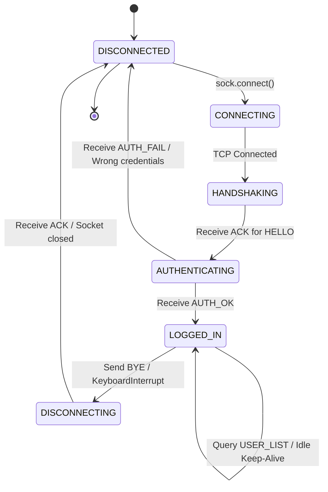

# System Architecture – Networking App Assignment

> **Scope:** Week 2 – State Management & Concurrency Implementation (Rubric 3 & 4)

---

## 1. Three-Layer Architecture

The system follows a strict three-tier separation of concerns:

---

## 2. Server Concurrency Architecture (Multi-threading)

To handle 10–20+ simultaneous clients without blocking the main event loop (Rubric 4), the Server employs a **thread-per-client model**:

- **Thread Isolation:** Each client connection is handled by a dedicated worker thread (`threading.Thread(target=self.handle_client, daemon=True)`). A slow or abruptly disconnected client does not block other clients or the server's primary `accept()` listener.
- **Thread Safety:** All read, write, and mutation operations on the active user registry are synchronized via `threading.Lock()`, completely preventing race conditions during concurrent client logins or logouts.

---

## 3. Sequence Diagram – Week 2 Authentication & Session Lifecycle

Connection, authentication, and session management lifecycle between Client and Server (Rubric 3 & 4):

---

## 4. Client State Machine

Client session transitions based on network events:

