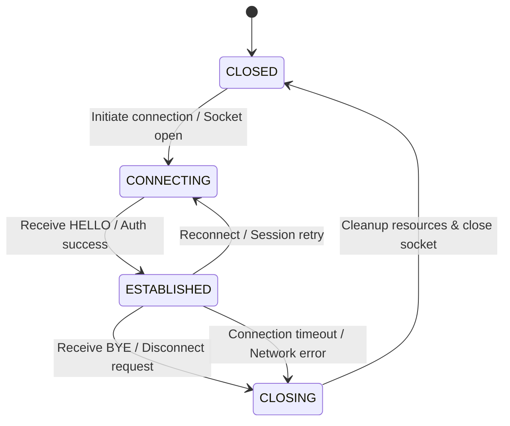
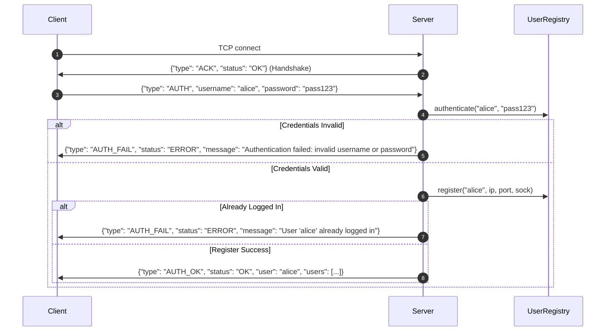
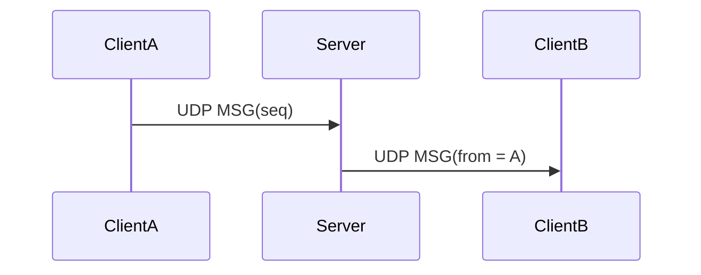
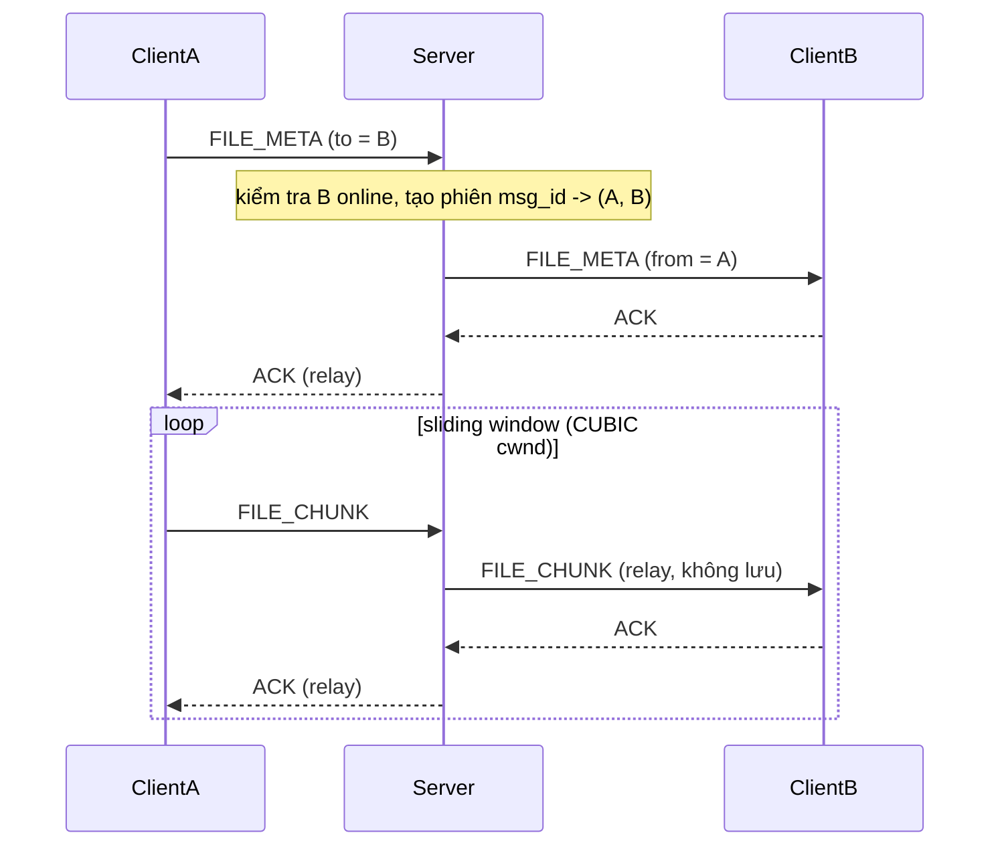
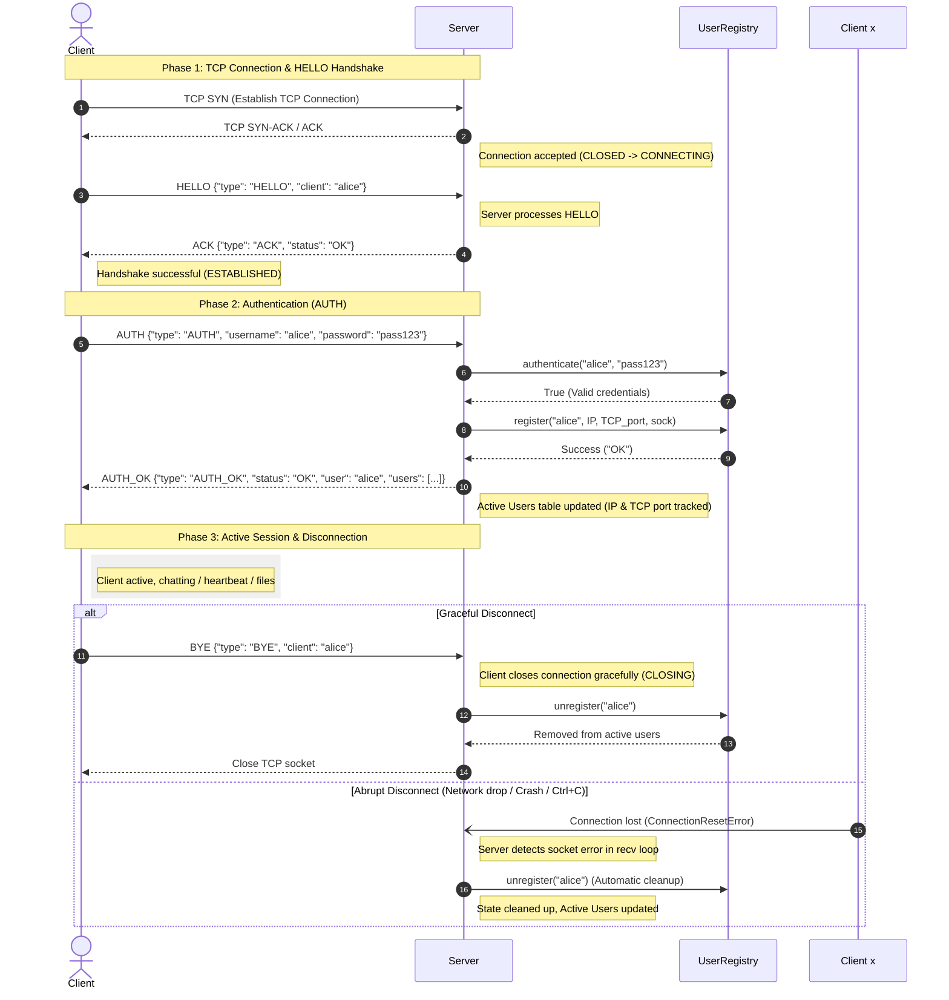
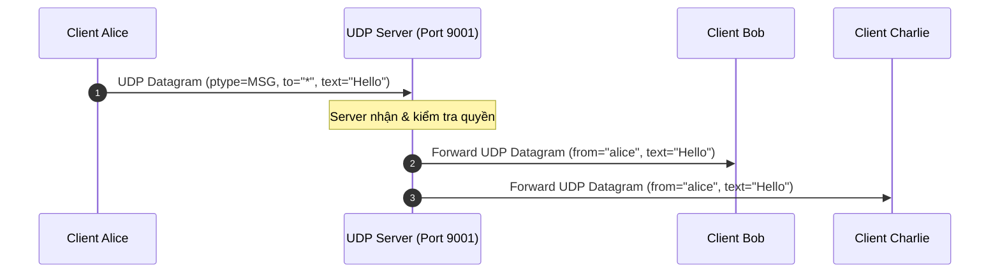
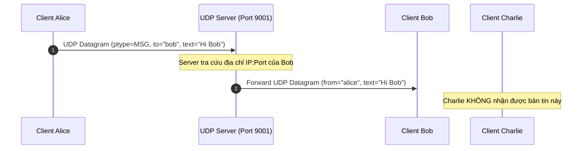
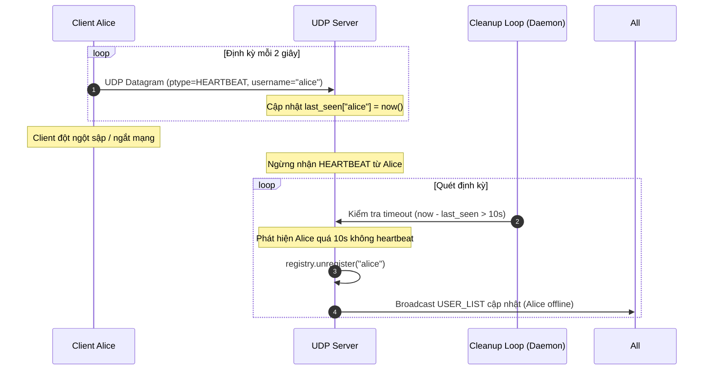

# Protocol Specification

## 1. Transport Overview (TCP 9000 / UDP 9001)

Core collaboration traffic uses raw sockets.

- **TCP port 9000**: Control channel for server hello, authentication, and liveness. Uses length-prefix framing to preserve message boundaries over TCP byte streams.
- **UDP port 9001**: Data channel for heartbeat, user discovery, real-time messaging, and file chunk transfer with application-layer reliability.

## 2. TCP Framing (Length-Prefix)

TCP is a stream-oriented transport protocol with no built-in message boundaries. Without framing, consecutive writes can suffer from packet coalescing (sticky packets) or network fragmentation, causing multiple messages to merge or split across `recv()` calls.

To ensure deterministic message parsing, all control traffic over TCP is enclosed in a length-prefixed frame:

```
+------------------------+------------------------------------+
|  Length (4 bytes, !I)  |  Payload data (Length bytes)       |
+------------------------+------------------------------------+
```

- **Length prefix (4 bytes)**: Unsigned 32-bit integer in network byte order (Big-Endian, struct format `!I`). Specifies the exact length of the payload that follows.
- **Payload**: UTF-8 encoded JSON object (e.g. `HELLO`, `AUTH`, `AUTH_OK`, `PING`, `PONG`).
- **Framing mechanism**:
  - **Sender (`send_frame`)**: Computes `len(payload)`, packs the 4-byte header, and sends `header + payload` via `sendall()`.
  - **Receiver (`recv_frame`)**: Reads exactly 4 bytes using a looped `recv()` (`recv_exact`) to decode the expected payload size, then reads exactly that number of bytes before handing the buffer to the JSON decoder. Returns `None` on clean socket closure.

## 3. Packet Format (UDP / Core Protocol)

UDP datagrams share a fixed 37-byte binary header followed by a variable-length payload. Fields are encoded in network byte order (Big-Endian).

Struct format: `!2sBBB II 16s H H I` (Total header size: 37 bytes).

### 3.1 Header Fields

| Field                 |     Size |      Type      | Description                                             | Example                    |
| --------------------- | -------: | :------------: | ------------------------------------------------------- | -------------------------- |
| Magic                 |  2 bytes |     `2s`     | Protocol identifier, fixed to `NP`                    | `b"NP"`                  |
| Version               |   1 byte | `B` (uint8) | Protocol version                                        | `1`                      |
| Type                  |   1 byte | `B` (uint8) | Packet type identifier                                  | `2` (`MSG`)            |
| Flags                 |   1 byte | `B` (uint8) | Bitmask control flags                                   | `1` (`FLAG_ENCRYPTED`) |
| Sequence number       |  4 bytes | `I` (uint32) | Monotonically increasing packet sequence number         | `1001`                   |
| Acknowledgment number |  4 bytes | `I` (uint32) | Sequence number being acknowledged                      | `1001`                   |
| Message ID            | 16 bytes |    `16s`    | Unique UUID v4 for the message or file transfer session | `uuid4().bytes`          |
| Chunk index           |  2 bytes | `H` (uint16) | Current chunk sequence (0-indexed)                      | `0`                      |
| Total chunks          |  2 bytes | `H` (uint16) | Total number of chunks in the transfer                  | `1`                      |
| Payload length        |  4 bytes | `I` (uint32) | Size of payload data following the header (bytes)       | `64`                     |

### 3.2 Packet Types

| Value | Name           | Description                                                 |
| :---: | -------------- | ----------------------------------------------------------- |
|   1   | `HEARTBEAT`  | Client periodic presence signal (`{"username": "..."}`)   |
|   2   | `MSG`        | Real-time chat message (unicast / broadcast)                |
|   3   | `FILE_META`  | File transfer metadata (filename, size, checksum)           |
|   4   | `FILE_CHUNK` | Raw binary chunk of a file                                  |
|   5   | `ACK`        | Acknowledgment packet carrying acknowledged sequence number |
|   6   | `USER_LIST`  | Broadcast list of currently active users                    |

### 3.3 Control Flags

| Bit | Name               |  Value  | Description                                    |
| :-: | ------------------ | :------: | ---------------------------------------------- |
|  0  | `FLAG_ENCRYPTED` | `0x01` | Payload is encrypted with Fernet               |
|  1  | `FLAG_END`       | `0x02` | Marks final packet / end-of-transmission chunk |

Payloads with `FLAG_ENCRYPTED` set are encrypted using Fernet symmetric encryption before transmission.

Reliable UDP uses sequence numbers, ACKs, retransmission timeouts, and a sliding window.

### 3.4 UDP Message Payloads

The payload that follows the 37-byte header is a UTF-8 encoded JSON object, unless the packet type says otherwise. `encode_packet()` in `protocol.py` encrypts every non-empty payload with Fernet by default and sets `FLAG_ENCRYPTED`; `decode_packet()` decrypts it automatically. The JSON examples below show the payload **before** encryption. (If the team decides to send Week 3 packets in plaintext for easier debugging, call `encode_packet(..., encrypt=False)` and update this paragraph.)

> **Two different `USER_LIST` messages:**
>
> - **TCP control message** (`{"type": "USER_LIST"}` request, `{"type": "USER_LIST", "status": "OK", "users": [...]}` response): the client asks for the list on demand. Each user is `{"username", "ip", "port"}`.
> - **UDP packet type 6**: pushed by the server to all clients when the set of online users changes. Payload is `{"users": ["alice", "bob"]}` (usernames only).

#### MSG (type = 2), Client <-> Server

Used for both broadcast and unicast chat messages.

| Field    | Type   | Required | Description                                               | Example            |
| -------- | ------ | :------: | --------------------------------------------------------- | ------------------ |
| `to`   | string |   Yes   | `"*"` for broadcast, otherwise the recipient's username | `"*"`, `"bob"` |
| `from` | string |   Yes   | Username of the sender                                    | `"alice"`        |
| `text` | string |   Yes   | Message content                                           | `"hello"`        |
| `time` | number |   Yes   | Unix timestamp in seconds, set by the sender              | `1761300000`     |

```json
{"to": "*", "from": "alice", "text": "hello everyone", "time": 1761300000}
```

```json
{"to": "bob", "from": "alice", "text": "hi bob", "time": 1761300005}
```

Routing rules:

- `to = "*"`: the server forwards the message to every online user (see the server plan for whether the sender is excluded).
- `to = <username>`: the server forwards the message only to that user.

#### HEARTBEAT (type = 1), Client -> Server

Sent periodically (every 2 seconds) by an authenticated client. The server updates the user's `last_seen` time. If no heartbeat arrives for 10 seconds, the server removes the user.

| Field        | Type   | Required | Description                          | Example     |
| ------------ | ------ | :------: | ------------------------------------ | ----------- |
| `username` | string |   Yes   | Username of the client that is alive | `"alice"` |

```json
{"username": "alice"}
```

#### USER_LIST (type = 6), Server -> Client

Sent by the server whenever the set of online users changes (a user logs in, leaves, or is removed by timeout).

| Field     | Type            | Required | Description                   | Example              |
| --------- | --------------- | :------: | ----------------------------- | -------------------- |
| `users` | array of string |   Yes   | Usernames of all online users | `["alice", "bob"]` |

```json
{"users": ["alice", "bob"]}
```

### 3.5 Header Field Values per Packet Type

| Packet type   | Flags (set by `encode_packet`) | Sequence number       | Ack number | Message ID        | Chunk index | Total chunks |
| ------------- | :------------------------------: | --------------------- | :--------: | ----------------- | :---------: | :----------: |
| `HEARTBEAT` |        `FLAG_ENCRYPTED`        | increasing per sender |   `0`   | 16 zero bytes     |    `0`    |    `1`    |
| `MSG`       |        `FLAG_ENCRYPTED`        | increasing per sender |   `0`   | `uuid4().bytes` |    `0`    |    `1`    |
| `USER_LIST` |        `FLAG_ENCRYPTED`        | increasing per server |   `0`   | 16 zero bytes     |    `0`    |    `1`    |

Notes:

- The sequence number starts at 1 and increases by 1 for every datagram a sender transmits. It is filled in now so that Week 4 only needs to add ACK handling and retransmission.
- The ack number stays `0` until the reliability layer is added.
- Every UDP datagram carries exactly one packet. No length prefix is used on UDP, because the datagram boundary already marks the end of the packet.
- Keep the whole datagram (header + payload) below about 1400 bytes to avoid IP fragmentation. Because Fernet encryption makes the payload roughly 4/3 of its plaintext size plus some tens of bytes, the plaintext JSON must be well under 1000 bytes. The helpers enforce `MAX_UDP_SIZE = 1400` bytes and `MAX_TEXT_LEN = 250` characters (250 Vietnamese characters with diacritics, 3 bytes each in UTF-8, still fit after encryption). Payload JSON is written as UTF-8, not `\uXXXX` escapes, otherwise accented text would be about twice as large.

### 3.6 Packet Helper Functions (`protocol.py`)

Helpers for building and parsing UDP packets. They are thin wrappers around the existing `Packet`, `encode_packet()` and `decode_packet()` in `protocol.py`. The server and the client must use these helpers instead of calling `struct` directly.

| Function                               | Description                                                                                                                |
| -------------------------------------- | -------------------------------------------------------------------------------------------------------------------------- |
| `build_udp(ptype, body, seq, ...)` | Builds a full datagram: 37-byte header + payload bytes. Returns `bytes`.                                                 |
| `parse_udp(data)`                    | Parses a datagram into a `Packet` and a body (dict, or raw bytes for `FILE_CHUNK`). Raises an error if the magic number, version, or payload length is invalid. |
| `pack_msg(to, sender, text, seq)`    | Convenience wrapper that builds a `MSG` packet (adds `time` automatically).                                            |
| `pack_heartbeat(username, seq)`      | Convenience wrapper that builds a `HEARTBEAT` packet.                                                                    |
| `pack_user_list(users, seq)`         | Convenience wrapper that builds a `USER_LIST` packet.                                                                    |
| `pack_file_meta(to, sender, ...)`    | Builds a `FILE_META` packet (`ptype=3`, JSON metadata, `total=chunks`).                                                  |
| `pack_file_chunk(msg_id, chunk, ...)`| Builds a `FILE_CHUNK` packet (`ptype=4`, raw binary payload, sets `FLAG_END` on final chunk).                            |
| `pack_ack(ack_seq, seq, msg_id, ...)`| Builds an `ACK` packet (`ptype=5`, empty payload, header carries `ack`, `msg_id`, `chunk`).                              |

Error handling: a datagram that is too short, has the wrong magic number, or whose declared payload length does not match the received data must be rejected with an error (and ignored by the receiver), never silently accepted.

## 4. Message Types & Protocol Vocabulary

This section defines the core application message types, protocol vocabulary, and connection state transitions for the client-server architecture.

To ensure clear communication between clients and the server, all application messages are categorized into a standardized protocol vocabulary.

### Message Types Table

| Value / Code | Name           |             Direction             | Transport | Description                                                                |
| :----------: | -------------- | :-------------------------------: | :-------: | -------------------------------------------------------------------------- |
|      -      | `HELLO`      | Client $\leftrightarrow$ Server | TCP / UDP | Initial handshake signal to establish connection readiness.                |
|      5      | `ACK`        | Client $\leftrightarrow$ Server |    UDP    | Acknowledgment packet carrying confirmation of received segments.          |
|      -      | `AUTH`       |   Client $\rightarrow$ Server   | TCP / UDP | Authentication payload carrying username and credentials for registration. |
|      2      | `MSG`        | Client $\leftrightarrow$ Server | UDP / TCP | Real-time chat message payload (broadcast or unicast).                     |
|      1      | `HEARTBEAT`  |   Client $\rightarrow$ Server   |    UDP    | Periodic liveness signal to maintain active session presence.              |
|      3      | `FILE_META`  | Client $\leftrightarrow$ Server | TCP / UDP | File transfer metadata including filename, size, and total chunks.         |
|      4      | `FILE_CHUNK` | Client $\leftrightarrow$ Server |    UDP    | Raw binary segment / chunk of an active file transfer.                     |
|      6      | `USER_LIST`  |   Server $\rightarrow$ Client   |    UDP    | Broadcast list of currently active users, sent when the user set changes.  |
|      -      | `BYE`        | Client $\leftrightarrow$ Server | TCP / UDP | Graceful disconnection notice indicating session teardown.                 |

## 5. Connection State Diagram

The connection lifecycle transitions through distinct states managed by event triggers on both the client and server sides.



## 6. Authentication Protocol (AUTH, AUTH_OK, AUTH_FAIL)

All authentication messages are exchanged over the TCP control channel (port 9000) using length-prefix framing with JSON payloads.

### 6.1 AUTH Request (Client -> Server)

Sent by the client immediately after the TCP handshake to authenticate and register its active session.

| Field        |  Type  | Required | Description                                                                                                                                                                                               | Example       |
| :----------- | :----: | :------: | :-------------------------------------------------------------------------------------------------------------------------------------------------------------------------------------------------------- | :------------ |
| `type`     | string |   Yes   | Message identifier, must be `"AUTH"`                                                                                                                                                                    | `"AUTH"`    |
| `username` | string |   Yes   | The user account name                                                                                                                                                                                     | `"alice"`   |
| `password` | string |   Yes   | The user account password                                                                                                                                                                                 | `"pass123"` |
| `udp_port` |  int  |    No    | The UDP port the client listens on to receive data-channel packets (not the server's port 9001). The server combines it with the client's IP address from `accept()` to know where to send UDP packets. | `50001`     |

**Example payload:**

```json
{
  "type": "AUTH",
  "username": "alice",
  "password": "pass123",
  "udp_port": 50001
}
```

### 6.2 AUTH_OK Response (Server -> Client)

Sent by the server when credentials are valid and the user is not currently logged in.

| Field         | Type            | Required | Description                                                 | Example                                                |
| ------------- | --------------- | :------: | ----------------------------------------------------------- | ------------------------------------------------------ |
| `type`      | string          |   Yes   | Must be `"AUTH_OK"`                                       | `"AUTH_OK"`                                          |
| `status`    | string          |   Yes   | Always `"OK"`                                             | `"OK"`                                               |
| `user`      | string          |   Yes   | The authenticated username                                  | `"alice"`                                            |
| `users`     | array of object |   Yes   | Currently online users, each `{"username", "ip", "port"}` | `[{"username":"bob","ip":"127.0.0.1","port":52134}]` |
| `user_list` | array of object |    No    | Duplicate of `users` kept for compatibility               | same as `users`                                      |

**Example payload:**

```json
{
  "type": "AUTH_OK",
  "status": "OK",
  "user": "alice",
  "users": [{"username": "bob", "ip": "127.0.0.1", "port": 52134}],
  "user_list": [{"username": "bob", "ip": "127.0.0.1", "port": 52134}]
}
```

### 6.3 AUTH_FAIL Response (Server -> Client)

Sent by the server when authentication is rejected.

| Field       | Type   | Required | Description                                                                | Example                              |
| ----------- | ------ | :------: | -------------------------------------------------------------------------- | ------------------------------------ |
| `type`    | string |   Yes   | Must be `"AUTH_FAIL"`                                                    | `"AUTH_FAIL"`                      |
| `status`  | string |   Yes   | Always `"ERROR"`                                                         | `"ERROR"`                          |
| `message` | string |   Yes   | Human-readable cause: invalid username/password, or user already logged in | `"User 'alice' already logged in"` |

**Example payload:**

```json
{
  "type": "AUTH_FAIL",
  "status": "ERROR",
  "message": "Authentication failed: invalid username or password"
}
```

### 6.4 Authentication Flow



## 7. Message Flow



> **Note:** `MSG` and `HEARTBEAT` are sent over plain UDP without ACK or retransmission, so a lost datagram is not recovered. Only file transfer (section 8) has reliability, using end-to-end ACKs. The sequence diagrams for broadcast, unicast, and heartbeat are in section 10.

## 8. File Flow



ACK là **đầu-cuối**: do FileReceiver (B) tạo, server chỉ chuyển tiếp theo bảng phiên; cửa sổ trượt và timer nằm hoàn toàn ở FileSender (A).

### 8.1 Tổng quan quy trình truyền file
Quy trình truyền file qua UDP giữa Client gửi (FileSender) và Client nhận (FileReceiver) thông qua Server relay:
1. **Khởi tạo phiên (`FILE_META`)**: FileSender gửi gói tin `FILE_META` mang thông tin tên file, kích thước, tổng số chunk và mã băm SHA-256. Server chuyển tiếp bản tin này đến người nhận và tạo phiên quản lý (`msg_id`). Phía nhận chuẩn bị bộ nhớ đệm và phản hồi `ACK`.
2. **Truyền dữ liệu nhị phân (`FILE_CHUNK`)**: FileSender chia nhỏ file thành các mảnh nhị phân (~700 bytes/mảnh), đánh số thứ tự từ `0` đến `total - 1`, gửi theo cửa sổ trượt (Sliding Window / CUBIC).
3. **Phản hồi xác nhận (`ACK`)**: FileReceiver nhận từng mảnh, lưu vào bộ đệm và lập tức gửi gói tin `ACK` xác nhận số thứ tự của mảnh đó.
4. **Kết thúc và kiểm tra toàn vẹn**: Mảnh cuối cùng có cờ `FLAG_END = 0x02`. Khi nhận đủ 100% các mảnh, FileReceiver ghép file, tính mã SHA-256 và so khớp với `checksum` ban đầu.

---

### 8.2 Đặc tả gói tin FILE_META (Packet type = 3)
Gói tin khởi tạo phiên truyền file. Header mang `ptype = 3`, `msg_id` phiên, và `total` là tổng số chunk. Payload là chuỗi JSON chứa metadata của file.

| Trường | Kiểu dữ liệu | Bắt buộc | Mô tả | Ví dụ |
| :--- | :---: | :---: | :--- | :--- |
| `to` | string | Có | Tên người nhận (username) hoặc `"*"` nếu gửi broadcast (server chuyển cho mọi user đang online trừ người gửi) | `"bob"` |
| `from` | string | Có | Tên người gửi (username) | `"alice"` |
| `filename` | string | Có | Tên file gốc (không bao gồm đường dẫn tuyệt đối) | `"report.pdf"` |
| `size` | int | Có | Kích thước file tính bằng byte | `1048576` |
| `chunks` | int | Có | Tổng số mảnh được chia nhỏ | `1500` |
| `checksum` | string | Có | Chuỗi băm SHA-256 (64 ký tự hex) của toàn bộ file gốc | `"e3b0c44298fc1c149afbf4c8..."` |

**Ví dụ Payload JSON:**
```json
{
  "to": "bob",
  "from": "alice",
  "filename": "report.pdf",
  "size": 1048576,
  "chunks": 1500,
  "checksum": "e3b0c44298fc1c149afbf4c8996fb92427ae41e4649b934ca495991b7852b855"
}
```

---

### 8.3 Đặc tả gói tin FILE_CHUNK (Packet type = 4)
Gói tin mang một mảnh dữ liệu nhị phân thô của file.
- **Header:**
  - `ptype = 4` (`FILE_CHUNK`).
  - `msg_id`: UUID phiên truyền file (khớp với `msg_id` trong `FILE_META`).
  - `seq`: Số thứ tự sequence của gói tin UDP.
  - `chunk`: Chỉ số của mảnh dữ liệu hiện tại (chỉ số 0-indexed: `0, 1, 2, ..., total - 1`).
  - `total`: Tổng số mảnh của file (`chunks`).
  - `flags`:
    - `0x01` (`FLAG_ENCRYPTED`): Payload được mã hóa với Fernet.
    - `0x02` (`FLAG_END`): Tự động bật khi `chunk == total - 1` để đánh dấu mảnh cuối cùng của phiên.
- **Payload:**
  - **Dữ liệu nhị phân trực tiếp (Raw Bytes)** của file, kích thước chuẩn khoảng 700 bytes để sau khi mã hóa Fernet vẫn nằm trong giới hạn an toàn `MAX_UDP_SIZE = 1400` bytes (tránh phân mảnh IP). Không parse JSON.

---

### 8.4 Đặc tả gói tin ACK (Packet type = 5)
Gói tin phản hồi xác nhận bên nhận đã nhận thành công một gói tin (bản tin chat, metadata hoặc mảnh file).
- **Header:**
  - `ptype = 5` (`ACK`).
  - `ack`: Số thứ tự sequence của gói tin được xác nhận (`ack_seq`).
  - `msg_id`: UUID phiên làm việc (nếu xác nhận mảnh file).
  - `chunk`: Chỉ số mảnh (`chunk index`) đang được xác nhận.
- **Payload:** Rỗng (`b""`, độ dài 0 byte). Mọi thông tin xác nhận đều nằm trong header 37 byte.

---

### 8.5 Cơ chế phát hiện và xử lý lỗi (Reliability & Error Handling)

1. **Mất gói và gửi lại (Packet Loss & Retransmission):**
   - Phía gửi (`FileSender`) duy trì cửa sổ trượt `cwnd` (`CubicController`) và bộ đếm thời gian RTO thích ứng (RFC 6298).
   - Nếu một mảnh gửi đi quá thời gian RTO mà chưa nhận được gói `ACK` tương ứng, sender coi như mảnh đó bị mất (`on_loss`), giảm `cwnd` 30% và tự động gửi lại (retransmit).
   - Phía `Server`: khi `FILE_META` hoặc `FILE_CHUNK` được gửi lại với cùng `msg_id`, Server cập nhật `last_activity` và chuyển tiếp lại sang người nhận mà không tạo phiên trùng lặp.

2. **Nhận lệch thứ tự (Out-of-order Delivery):**
   - Do đặc tính của UDP, các gói `FILE_CHUNK` có thể đến lệch thứ tự (ví dụ `chunk 2` đến trước `chunk 1`).
   - `Server` chuyển tiếp độc lập từng gói `FILE_CHUNK` ngay khi nhận được (không giữ bộ đệm mảnh, tránh Head-of-Line blocking).
   - `FileReceiver` lưu các mảnh vào một từ điển đệm (buffer) theo `chunk index`. Receiver chỉ bắt đầu ghép file khi đã thu thập đủ 100% các mảnh từ `0` đến `total - 1`.

3. **Gói tin trùng lặp (Duplicate Packets):**
   - Nếu gói tin `ACK` bị mất hoặc mạng bị trễ khiến bên gửi truyền lại mảnh mà bên nhận đã có:
   - `Server` cho phép chuyển tiếp mọi gói `FILE_META`, `FILE_CHUNK` và `ACK` gửi lại thuộc phiên đang mở.
   - `FileReceiver` kiểm tra `chunk index`, nếu đã có trong bộ đệm thì bỏ qua không ghi đè, **nhưng vẫn gửi lại gói `ACK`** tương ứng để phía gửi biết và trượt cửa sổ gửi tiếp.

4. **Kiểm tra tính toàn vẹn (Integrity Verification & Corrupted File):**
   - `Server` dùng `parse_udp()` kiểm tra header 37 bytes, giải mã Fernet và kiểm tra tính hợp lệ của `FILE_META` (`filename`, `size >= 0`, `chunks >= 1`, `checksum` SHA-256 64 ký tự hex) cũng như giới hạn chỉ số mảnh (`0 <= chunk < total`). Gói hỏng hoặc sai định dạng bị loại bỏ an toàn.
   - Sau khi nhận đủ tất cả các mảnh, `FileReceiver` ghép toàn bộ các mảnh nhị phân lại thành nội dung file hoàn chỉnh theo đúng thứ tự từ 0 đến `total - 1`.
   - Tính toán mã băm SHA-256 trên nội dung vừa ghép:
     - **Nếu SHA-256 khớp với `checksum` trong `FILE_META`**: File hợp lệ 100%, ghi file vào thư mục lưu trữ `downloads/` và thông báo hoàn tất.
     - **Nếu SHA-256 không khớp**: File bị lỗi hoặc hỏng trong quá trình truyền. Receiver hủy toàn bộ dữ liệu tạm của file đó, ghi log báo lỗi và không lưu file hỏng vào ổ đĩa.

5. **Hủy phiên do quá hạn hoặc rời mạng (Session Timeout & Peer Disconnect):**
   - Nếu trong vòng **30 giây** (`FILE_SESSION_TIMEOUT = 30.0`) mà không có bất kỳ gói tin mới nào đến cho một phiên truyền file (`msg_id`), cả `Server` (`cleanup_file_sessions`), `FileSender` và `FileReceiver` sẽ tự động hủy phiên và giải phóng tài nguyên bộ nhớ đệm để tránh rò rỉ bộ nhớ (memory leak).
   - Nếu người gửi hoặc người nhận cuối cùng ngắt kết nối (`BYE` / mất heartbeat quá `10s`), `Server` tự động đóng phiên truyền file tương ứng (`close_sessions_for_user`) và ghi log.

---

### 8.6 Server Relay File & Quản lý phiên (`server.py`)

Thiết kế nhóm chọn: **1A – File đi qua Server** (`Alice -> Server -> Bob`) và **2A – ACK đầu-cuối** (`Bob` gửi `ACK`, `Server` chỉ chuyển tiếp, không lưu mảnh).

- **Bảng phiên (`file_sessions`)**: Ánh xạ `msg_id -> FileSession(sender, sender_addr, receivers, receiver_addrs, ...)` lưu cặp `(địa chỉ A, địa chỉ B)` và thời điểm hoạt động gần nhất (`last_activity`).
- **Tái sử dụng hoàn toàn `protocol.py`**:
  - Giải mã và kiểm tra gói đến bằng `parse_udp(data)`.
  - Đóng gói và chuyển tiếp bằng đúng bộ hàm helper có sẵn: `pack_file_meta()`, `pack_file_chunk()`, `pack_ack()`.
- **Vòng đời phiên & Logging**: Ghi log khi mở phiên (người gửi, địa chỉ A, người nhận, địa chỉ B, tên file, kích thước, tổng số chunk) và khi đóng phiên (lý do đóng, tổng số gói chuyển mỗi chiều `A->B`, `B->A`, thời lượng phiên).

---

### 8.7 Điều khiển tắc nghẽn CUBIC & RTO thích ứng (`congestion.py`)

`CubicController` kết hợp cùng `RttEstimator` (RFC 6298) điều khiển tốc độ gửi của `FileSender` (đơn vị: số mảnh `FILE_CHUNK` đang bay trên mạng).

| Thành phần | Mô tả |
| :--- | :--- |
| `cwnd` | Bắt đầu `2` mảnh (`INITIAL_CWND = 2`), tối đa `64` mảnh (`MAX_CWND = 64`), không giảm dưới `2` mảnh (`MIN_CWND = 2`). |
| Slow start | `ssthresh` ban đầu = `64`; mỗi `ACK` nhận được tăng `cwnd` thêm `1.0` cho tới khi gặp mất gói hoặc `cwnd >= ssthresh`. |
| Congestion avoidance | Sau lần mất gói, `cwnd` tăng theo hàm CUBIC `W(t) = C * (t - K)^3 + W_max` (`C = 0.4`, `K = ((W_max - cwnd) / C)^(1/3)`). |
| Mất gói (Timeout) | Quá `rto` chưa có `ACK` = mất gói: lưu `W_max = cwnd`, giảm `cwnd = 0.7 * cwnd` (giảm 30%), đặt `ssthresh = cwnd`. Nhiều mảnh timeout trong cùng một lượt chỉ tính **1** lần mất. |
| RTT / RTO (RFC 6298) | `SRTT = 7/8 * SRTT + 1/8 * RTT`, `RTTVAR = 3/4 * RTTVAR + 1/4 * |SRTT - RTT|`, `RTO = SRTT + 4 * RTTVAR` (kẹp trong khoảng `0.2s`–`8.0s`); khi timeout thì `RTO` nhân đôi (exponential backoff). |
| Thuật toán Karn | Mảnh đã gửi lại (retransmitted) không dùng làm mẫu đo RTT (`on_ack(None)`). |

**Giao diện cho `FileSender`:**
- `can_send(inflight) -> bool`: Trả về `True` nếu `inflight < int(cwnd)`.
- `on_ack(rtt=None)`: Gọi khi nhận `ACK`; truyền `rtt = None` nếu mảnh đó đã từng phải gửi lại.
- `on_loss(sent_time=None) -> bool`: Gọi khi mảnh bị timeout; gộp các mảnh timeout cùng lượt thành 1 lần giảm `cwnd`.
- `rto -> float`: Giá trị timeout hiện tại (giây) để kiểm tra các mảnh chưa được xác nhận.

## 9. Connection Sequence Diagram (Handshake -> Auth -> Disconnect)

Sơ đồ trình tự (Sequence Diagram) mô tả toàn bộ vòng đời kết nối từ lúc Client thiết lập TCP, gửi bản tin `HELLO`, thực hiện xác thực `AUTH`, duy trì phiên và ngắt kết nối an toàn (`BYE` hoặc ngắt đột ngột):



## 10. Sequence Diagram cho Broadcast, Unicast và Heartbeat

a) Sequence Diagram cho Broadcast chat



b) Sequence Diagram cho Unicast chat



c) Sequence Diagram cho Heartbeat



