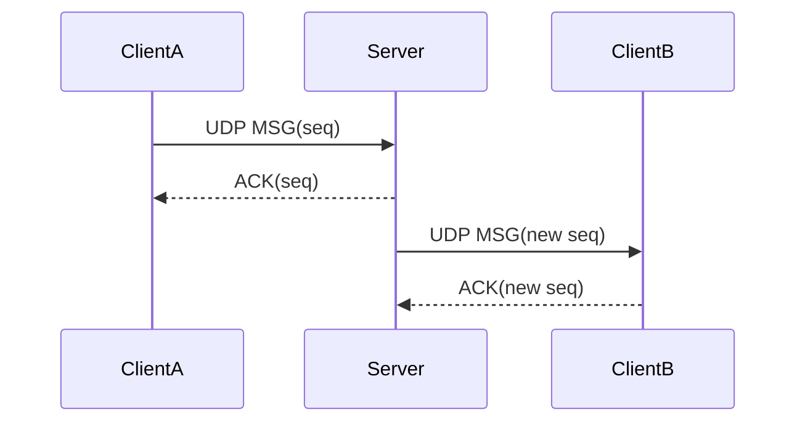
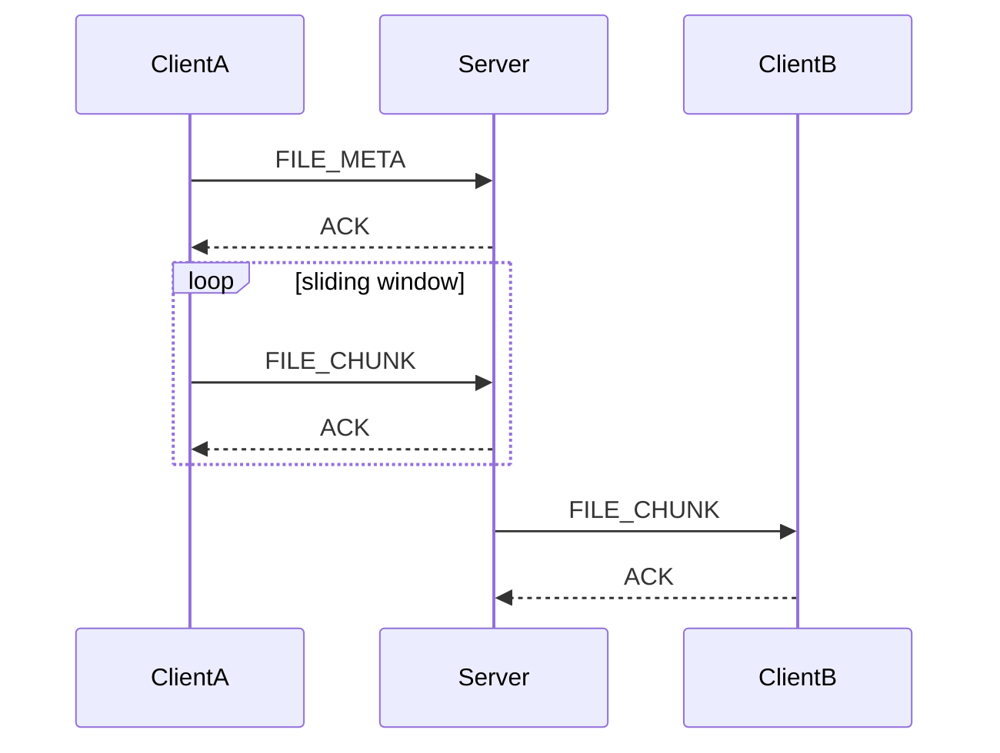
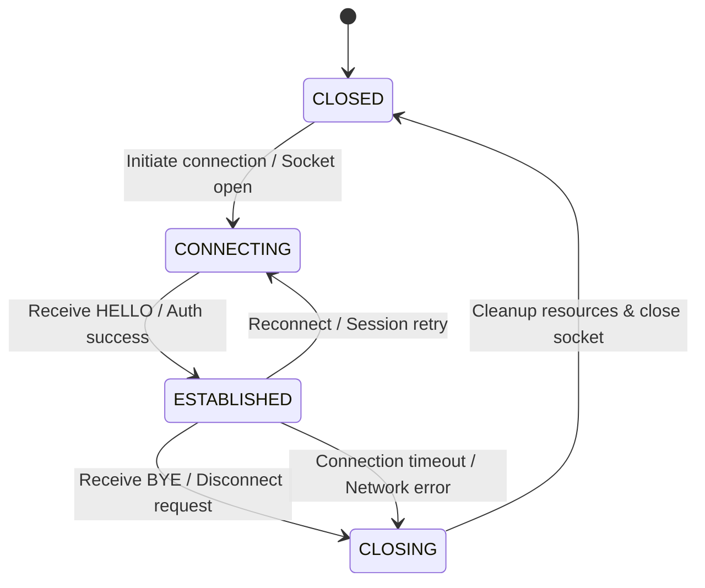
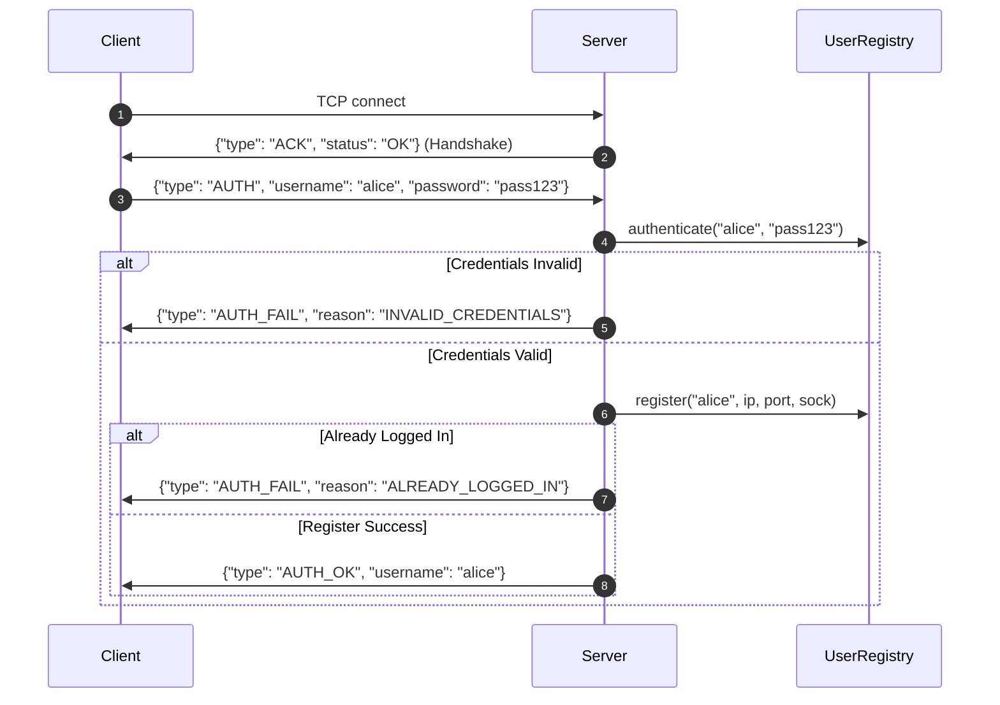

# Protocol Specification

Core collaboration traffic uses raw sockets.

- **TCP port 9000**: Control channel for server hello, authentication, and liveness. Uses length-prefix framing to preserve message boundaries over TCP byte streams.
- **UDP port 9001**: Data channel for heartbeat, user discovery, real-time messaging, and file chunk transfer with application-layer reliability.

## 1. TCP Framing (Length-Prefix)

TCP is a stream-oriented transport protocol with no built-in message boundaries. Without framing, consecutive writes can suffer from packet coalescing (sticky packets) or network fragmentation, causing multiple messages to merge or split across `recv()` calls.

To ensure deterministic message parsing, all control traffic over TCP is enclosed in a length-prefixed frame:

```
+------------------------+------------------------------------+
|  Length (4 bytes, !I)  |  Payload data (Length bytes)       |
+------------------------+------------------------------------+
```

- **Length prefix (4 bytes)**: Unsigned 32-bit integer in network byte order (Big-Endian, struct format `!I`). Specifies the exact length of the payload that follows.
- **Payload**: UTF-8 encoded JSON object (e.g. `HELLO`, `AUTH`, `AUTH_OK`, `PING`, `PONG`).
- **Framing mechanism**:
  - **Sender (`send_frame`)**: Computes `len(payload)`, packs the 4-byte header, and sends `header + payload` via `sendall()`.
  - **Receiver (`recv_frame`)**: Reads exactly 4 bytes using a looped `recv()` (`recv_exact`) to decode the expected payload size, then reads exactly that number of bytes before handing the buffer to the JSON decoder. Returns `None` on clean socket closure.

## 2. Packet Format (UDP / Core Protocol)

UDP datagrams share a fixed 37-byte binary header followed by a variable-length payload. Fields are encoded in network byte order (Big-Endian).

Struct format: `!2sBBB II 16s H H I` (Total header size: 37 bytes).

### Header Fields

| Field | Size | Type | Description | Example |
| --- | ---: | :---: | --- | --- |
| Magic | 2 bytes | `2s` | Protocol identifier, fixed to `NP` | `b"NP"` |
| Version | 1 byte | `B` (uint8) | Protocol version | `1` |
| Type | 1 byte | `B` (uint8) | Packet type identifier | `2` (`MSG`) |
| Flags | 1 byte | `B` (uint8) | Bitmask control flags | `1` (`FLAG_ENCRYPTED`) |
| Sequence number | 4 bytes | `I` (uint32) | Monotonically increasing packet sequence number | `1001` |
| Acknowledgment number | 4 bytes | `I` (uint32) | Sequence number being acknowledged | `1001` |
| Message ID | 16 bytes | `16s` | Unique UUID v4 for the message or file transfer session | `uuid4().bytes` |
| Chunk index | 2 bytes | `H` (uint16) | Current chunk sequence (0-indexed) | `0` |
| Total chunks | 2 bytes | `H` (uint16) | Total number of chunks in the transfer | `1` |
| Payload length | 4 bytes | `I` (uint32) | Size of payload data following the header (bytes) | `64` |

### Packet Types

| Value | Name | Description |
| :---: | --- | --- |
| 1 | `HEARTBEAT` | Client periodic presence signal (`{"username": "..."}`) |
| 2 | `MSG` | Real-time chat message (unicast / broadcast) |
| 3 | `FILE_META` | File transfer metadata (filename, size, checksum) |
| 4 | `FILE_CHUNK` | Raw binary chunk of a file |
| 5 | `ACK` | Acknowledgment packet carrying acknowledged sequence number |
| 6 | `USER_LIST` | Broadcast list of currently active users |

### Control Flags

| Bit | Name | Value | Description |
| :---: | --- | :---: | --- |
| 0 | `FLAG_ENCRYPTED` | `0x01` | Payload is encrypted with Fernet |
| 1 | `FLAG_END` | `0x02` | Marks final packet / end-of-transmission chunk |

Payloads with `FLAG_ENCRYPTED` set are encrypted using Fernet symmetric encryption before transmission.

Reliable UDP uses sequence numbers, ACKs, retransmission timeouts, and a sliding window.

## 3. Message Flow



## 4. File Flow



# Protocol Specification & Connection States

This section defines the core application message types, protocol vocabulary, and connection state transitions for the client-server architecture.

## 1. Message Types & Protocol Vocabulary

To ensure clear communication between clients and the server, all application messages are categorized into a standardized protocol vocabulary.

### Message Types Table

| Value / Code | Name | Direction | Transport | Description |
| :---: | --- | :---: | :---: | --- |
| - | `HELLO` | Client $\leftrightarrow$ Server | TCP / UDP | Initial handshake signal to establish connection readiness. |
| 5 | `ACK` | Client $\leftrightarrow$ Server | UDP | Acknowledgment packet carrying confirmation of received segments. |
| - | `AUTH` | Client $\rightarrow$ Server | TCP / UDP | Authentication payload carrying username and credentials for registration. |
| 2 | `MSG` | Client $\leftrightarrow$ Server | UDP / TCP | Real-time chat message payload (broadcast or unicast). |
| 1 | `HEARTBEAT` | Client $\rightarrow$ Server | UDP | Periodic liveness signal to maintain active session presence. |
| 3 | `FILE_META` | Client $\leftrightarrow$ Server | TCP / UDP | File transfer metadata including filename, size, and total chunks. |
| 4 | `FILE_CHUNK` | Client $\leftrightarrow$ Server | UDP | Raw binary segment / chunk of an active file transfer. |
| - | `BYE` | Client $\leftrightarrow$ Server | TCP / UDP | Graceful disconnection notice indicating session teardown. |

## 2. Connection State Diagram

The connection lifecycle transitions through distinct states managed by event triggers on both the client and server sides.



## 3. Authentication Protocol Specification (AUTH, AUTH_OK, AUTH_FAIL)

All authentication messages are exchanged over the TCP control channel (port 9000) using length-prefix framing with JSON payloads.

### 3.1. AUTH Request (Client -> Server)
Sent by the client immediately after the TCP handshake to authenticate and register its active session.

| Field | Type | Required | Description | Example |
| :--- | :---: | :---: | :--- | :--- |
| `type` | string | Yes | Message identifier, must be `"AUTH"` | `"AUTH"` |
| `username` | string | Yes | The user account name | `"alice"` |
| `password` | string | Yes | The user account password | `"pass123"` |
| `udp_port` | int | No | The client's listening UDP port for data channel | `9001` |

**Example payload:**
```json
{
  "type": "AUTH",
  "username": "alice",
  "password": "pass123",
  "udp_port": 9001
}
```

### 3.2. AUTH_OK Response (Server -> Client)
Sent by the server when credentials are valid and the user is not currently logged in.

| Field | Type | Required | Description | Example |
| :--- | :---: | :---: | :--- | :--- |
| `type` | string | Yes | Message identifier, must be `"AUTH_OK"` | `"AUTH_OK"` |
| `username` | string | Yes | The authenticated username | `"alice"` |
| `message` | string | No | Informational success message | `"Authentication successful"` |

**Example payload:**
```json
{
  "type": "AUTH_OK",
  "username": "alice",
  "message": "Authentication successful"
}
```

### 3.3. AUTH_FAIL Response (Server -> Client)
Sent by the server when authentication is rejected.

| Field | Type | Required | Description | Example |
| :--- | :---: | :---: | :--- | :--- |
| `type` | string | Yes | Message identifier, must be `"AUTH_FAIL"` | `"AUTH_FAIL"` |
| `reason` | string | Yes | Standard error code: `INVALID_CREDENTIALS`, `ALREADY_LOGGED_IN`, or `MALFORMED_REQUEST` | `"ALREADY_LOGGED_IN"` |
| `message` | string | No | Human-readable explanation of failure | `"Account is already logged in"` |

**Standard Reason Codes:**
- `INVALID_CREDENTIALS`: Username does not exist in `users.json` or password does not match.
- `ALREADY_LOGGED_IN`: An active session for this username already exists in `UserRegistry`.
- `MALFORMED_REQUEST`: The `AUTH` payload is missing required fields or is not valid JSON.

### 3.4. Authentication Flow


# Sequence Diagram Handshake -> Auth -> Disconnect
sequenceDiagram
    autonumber
    actor Client
    participant Server
    participant UserRegistry

    Note over Client,Server: Phase 1: TCP Connection & HELLO Handshake
    Client->>Server: TCP SYN (Establish TCP Connection)
    Server-->>Client: TCP SYN-ACK / ACK
    Note right of Server: Connection accepted (CLOSED → CONNECTING)

    Client->>Server: HELLO {"type": "HELLO", "client": "alice"}
    Note right of Server: Server processes HELLO
    Server-->>Client: ACK {"type": "ACK", "status": "OK"}
    Note right of Client: Handshake successful (ESTABLISHED)

    Note over Client,Server: Phase 2: Authentication (AUTH)
    Client->>Server: AUTH {"type": "AUTH", "username": "alice", "password": "pass123"}
    Server->>UserRegistry: authenticate("alice", "pass123")
    UserRegistry-->>Server: True (Valid credentials)
    Server->>UserRegistry: register("alice", IP, TCP_port, sock)
    UserRegistry-->>Server: Success ("OK")
    Server-->>Client: AUTH_OK {"type": "AUTH_OK", "status": "OK", "active_users": [...]}
    Note right of Server: Active Users table updated (IP & TCP port tracked)

    Note over Client,Server: Phase 3: Active Session & Disconnection
    rect rgb(240, 240, 240)
        Note right of Client: Client active, chatting / heartbeat / files
    end

    alt Graceful Disconnect
        Client->>Server: BYE {"type": "BYE", "client": "alice"}
        Note right of Server: Client closes connection gracefully (CLOSING)
        Server->>UserRegistry: unregister("alice")
        UserRegistry-->>Server: Removed from active users
        Server-->>Client: Close TCP socket
    else Abrupt Disconnect (Network drop / Crash / Ctrl+C)
        Client x-) Server: Connection lost (ConnectionResetError)
        Note right of Server: Server detects socket error in recv loop
        Server->>UserRegistry: unregister("alice") (Automatic cleanup)
        Note right of Server: State cleaned up, Active Users updated
    end
