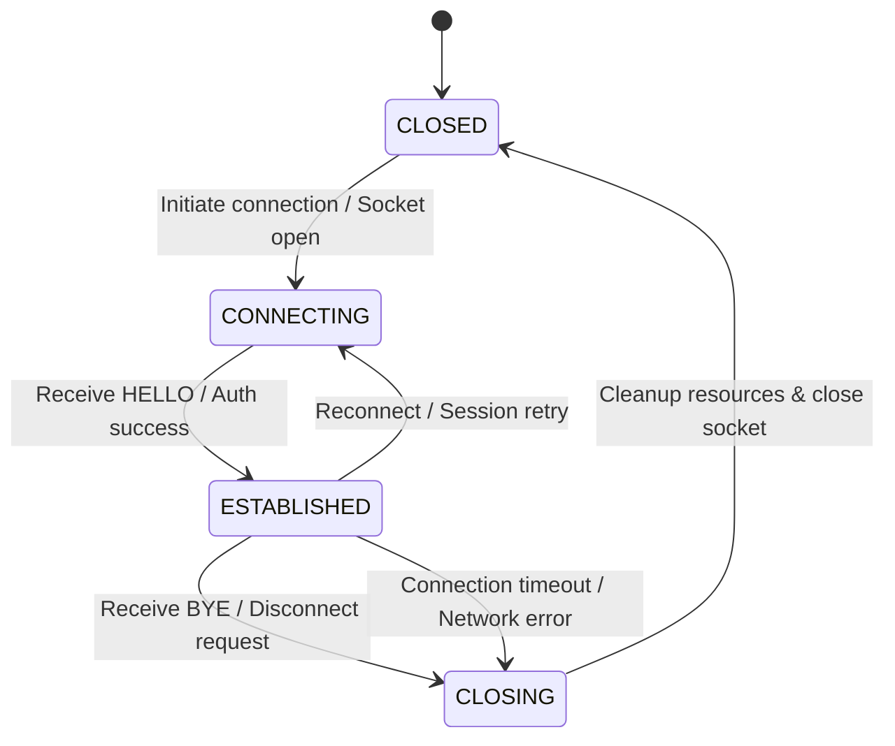
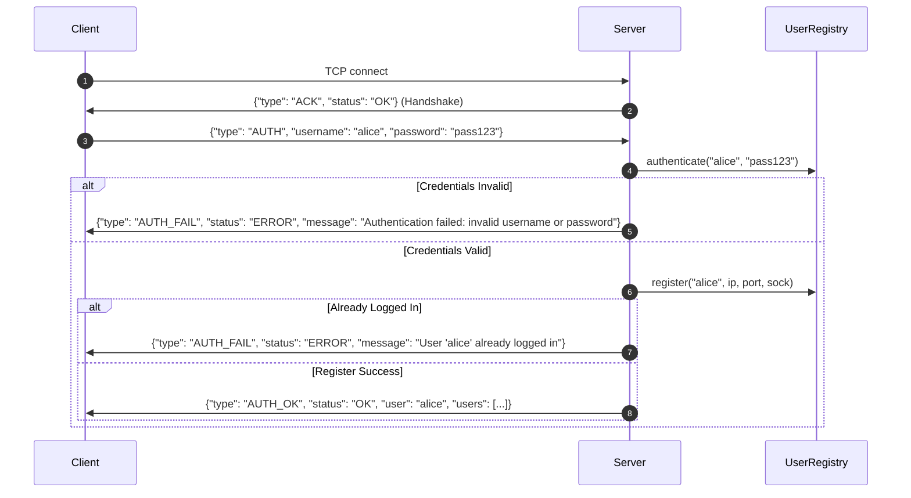
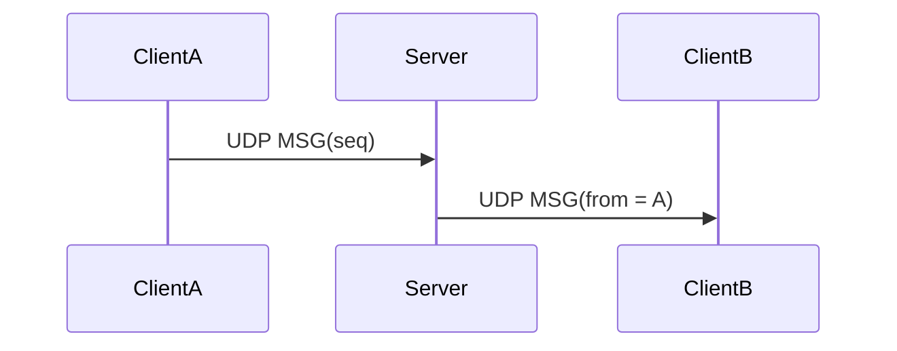
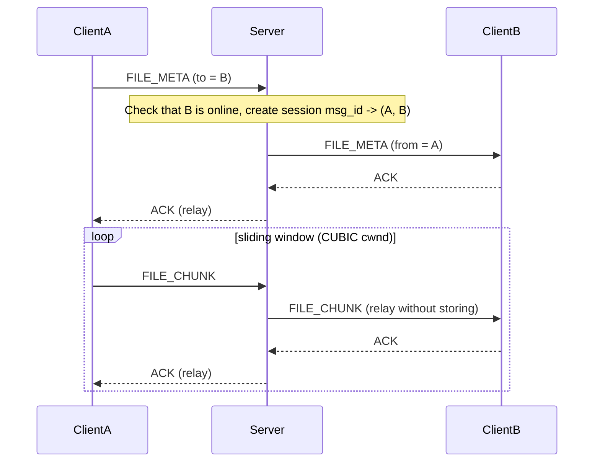
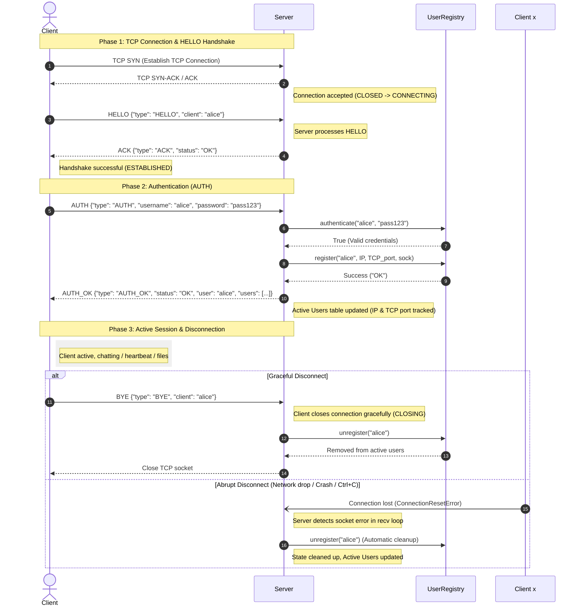
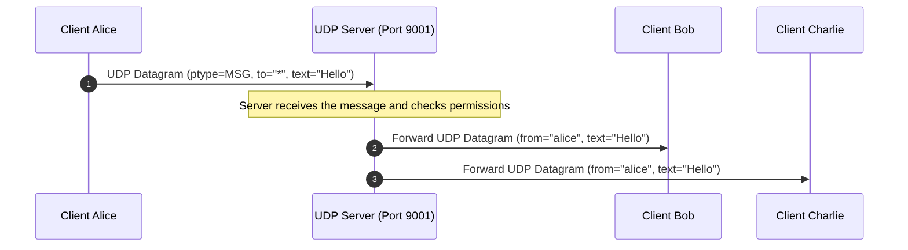
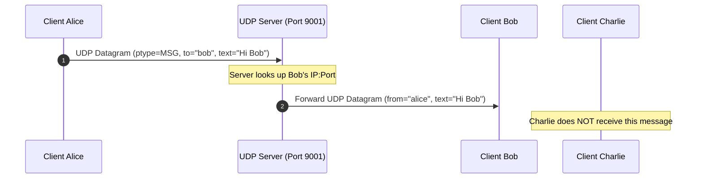
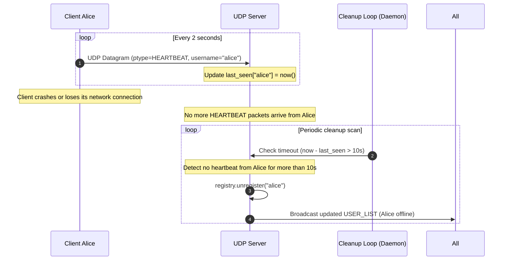
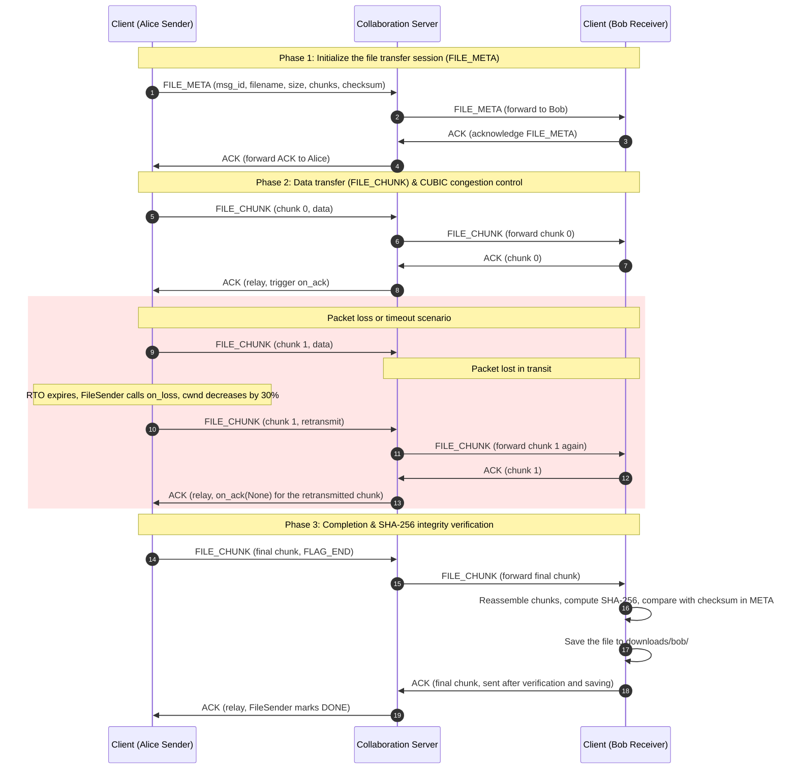

# Protocol Specification

## 1. Transport Overview (TCP 9000 / UDP 9001)

Core collaboration traffic uses raw sockets.

- **TCP port 9000**: Control channel for server hello, authentication, and liveness. Uses length-prefix framing to preserve message boundaries over TCP byte streams.
- **UDP port 9001**: Data channel for heartbeat, user discovery, real-time messaging, and file chunk transfer with application-layer reliability.

## 2. TCP Framing (Length-Prefix)

TCP is a stream-oriented transport protocol with no built-in message boundaries. Without framing, consecutive writes can suffer from packet coalescing (sticky packets) or network fragmentation, causing multiple messages to merge or split across `recv()` calls.

To ensure deterministic message parsing, all control traffic over TCP is enclosed in a length-prefixed frame:

```
+------------------------+------------------------------------+
|  Length (4 bytes, !I)  |  Payload data (Length bytes)       |
+------------------------+------------------------------------+
```

- **Length prefix (4 bytes)**: Unsigned 32-bit integer in network byte order (Big-Endian, struct format `!I`). Specifies the exact length of the payload that follows.
- **Payload**: UTF-8 encoded JSON object (e.g. `HELLO`, `AUTH`, `AUTH_OK`, `PING`, `PONG`).
- **Framing mechanism**:
  - **Sender (`send_frame`)**: Computes `len(payload)`, packs the 4-byte header, and sends `header + payload` via `sendall()`.
  - **Receiver (`recv_frame`)**: Reads exactly 4 bytes using a looped `recv()` (`recv_exact`) to decode the expected payload size, then reads exactly that number of bytes before handing the buffer to the JSON decoder. Returns `None` on clean socket closure.

## 3. Packet Format (UDP / Core Protocol)

UDP datagrams share a fixed 37-byte binary header followed by a variable-length payload. Fields are encoded in network byte order (Big-Endian).

Struct format: `!2sBBB II 16s H H I` (Total header size: 37 bytes).

### 3.1 Header Fields

| Field                 |     Size |      Type      | Description                                             | Example                    |
| --------------------- | -------: | :------------: | ------------------------------------------------------- | -------------------------- |
| Magic                 |  2 bytes |     `2s`     | Protocol identifier, fixed to `NP`                    | `b"NP"`                  |
| Version               |   1 byte | `B` (uint8) | Protocol version                                        | `1`                      |
| Type                  |   1 byte | `B` (uint8) | Packet type identifier                                  | `2` (`MSG`)            |
| Flags                 |   1 byte | `B` (uint8) | Bitmask control flags                                   | `1` (`FLAG_ENCRYPTED`) |
| Sequence number       |  4 bytes | `I` (uint32) | Monotonically increasing packet sequence number         | `1001`                   |
| Acknowledgment number |  4 bytes | `I` (uint32) | Sequence number being acknowledged                      | `1001`                   |
| Message ID            | 16 bytes |    `16s`    | Unique UUID v4 for the message or file transfer session | `uuid4().bytes`          |
| Chunk index           |  2 bytes | `H` (uint16) | Current chunk sequence (0-indexed)                      | `0`                      |
| Total chunks          |  2 bytes | `H` (uint16) | Total number of chunks in the transfer                  | `1`                      |
| Payload length        |  4 bytes | `I` (uint32) | Size of payload data following the header (bytes)       | `64`                     |

### 3.2 Packet Types

| Value | Name           | Description                                                 |
| :---: | -------------- | ----------------------------------------------------------- |
|   1   | `HEARTBEAT`  | Client periodic presence signal (`{"username": "..."}`)   |
|   2   | `MSG`        | Real-time chat message (unicast / broadcast)                |
|   3   | `FILE_META`  | File transfer metadata (filename, size, checksum)           |
|   4   | `FILE_CHUNK` | Raw binary chunk of a file                                  |
|   5   | `ACK`        | Acknowledgment packet carrying acknowledged sequence number |
|   6   | `USER_LIST`  | Broadcast list of currently active users                    |

### 3.3 Control Flags

| Bit | Name               |  Value  | Description                                    |
| :-: | ------------------ | :------: | ---------------------------------------------- |
|  0  | `FLAG_ENCRYPTED` | `0x01` | Payload is encrypted with Fernet               |
|  1  | `FLAG_END`       | `0x02` | Marks final packet / end-of-transmission chunk |

Payloads with `FLAG_ENCRYPTED` set are encrypted using Fernet symmetric encryption before transmission.

Reliable UDP uses sequence numbers, ACKs, retransmission timeouts, and a sliding window.

### 3.4 UDP Message Payloads

The payload that follows the 37-byte header is a UTF-8 encoded JSON object, unless the packet type says otherwise. `encode_packet()` in `protocol.py` encrypts every non-empty payload with Fernet by default and sets `FLAG_ENCRYPTED`; `decode_packet()` decrypts it automatically. The JSON examples below show the payload **before** encryption. (If the team decides to send Week 3 packets in plaintext for easier debugging, call `encode_packet(..., encrypt=False)` and update this paragraph.)

> **Two different `USER_LIST` messages:**
>
> - **TCP control message** (`{"type": "USER_LIST"}` request, `{"type": "USER_LIST", "status": "OK", "users": [...]}` response): the client asks for the list on demand. Each user is `{"username", "ip", "port"}`.
> - **UDP packet type 6**: pushed by the server to all clients when the set of online users changes. Payload is `{"users": ["alice", "bob"]}` (usernames only).

#### MSG (type = 2), Client <-> Server

Used for both broadcast and unicast chat messages.

| Field    | Type   | Required | Description                                               | Example            |
| -------- | ------ | :------: | --------------------------------------------------------- | ------------------ |
| `to`   | string |   Yes   | `"*"` for broadcast, otherwise the recipient's username | `"*"`, `"bob"` |
| `from` | string |   Yes   | Username of the sender                                    | `"alice"`        |
| `text` | string |   Yes   | Message content                                           | `"hello"`        |
| `time` | number |   Yes   | Unix timestamp in seconds, set by the sender              | `1761300000`     |

```json
{"to": "*", "from": "alice", "text": "hello everyone", "time": 1761300000}
```

```json
{"to": "bob", "from": "alice", "text": "hi bob", "time": 1761300005}
```

Routing rules:

- `to = "*"`: the server forwards the message to every online user (see the server plan for whether the sender is excluded).
- `to = <username>`: the server forwards the message only to that user.

#### HEARTBEAT (type = 1), Client -> Server

Sent periodically (every 2 seconds) by an authenticated client. The server updates the user's `last_seen` time. If no heartbeat arrives for 10 seconds, the server removes the user.

| Field        | Type   | Required | Description                          | Example     |
| ------------ | ------ | :------: | ------------------------------------ | ----------- |
| `username` | string |   Yes   | Username of the client that is alive | `"alice"` |

```json
{"username": "alice"}
```

#### USER_LIST (type = 6), Server -> Client

Sent by the server whenever the set of online users changes (a user logs in, leaves, or is removed by timeout).

| Field     | Type            | Required | Description                   | Example              |
| --------- | --------------- | :------: | ----------------------------- | -------------------- |
| `users` | array of string |   Yes   | Usernames of all online users | `["alice", "bob"]` |

```json
{"users": ["alice", "bob"]}
```

### 3.5 Header Field Values per Packet Type

| Packet type   | Flags (set by `encode_packet`) | Sequence number       | Ack number | Message ID        | Chunk index | Total chunks |
| ------------- | :------------------------------: | --------------------- | :--------: | ----------------- | :---------: | :----------: |
| `HEARTBEAT` |        `FLAG_ENCRYPTED`        | increasing per sender |   `0`   | 16 zero bytes     |    `0`    |    `1`    |
| `MSG`       |        `FLAG_ENCRYPTED`        | increasing per sender |   `0`   | `uuid4().bytes` |    `0`    |    `1`    |
| `USER_LIST` |        `FLAG_ENCRYPTED`        | increasing per server |   `0`   | 16 zero bytes     |    `0`    |    `1`    |

Notes:

- The sequence number starts at 1 and increases by 1 for every datagram a sender transmits. It is filled in now so that Week 4 only needs to add ACK handling and retransmission.
- The ack number stays `0` until the reliability layer is added.
- Every UDP datagram carries exactly one packet. No length prefix is used on UDP, because the datagram boundary already marks the end of the packet.
- Keep the whole datagram (header + payload) below about 1400 bytes to avoid IP fragmentation. Because Fernet encryption makes the payload roughly 4/3 of its plaintext size plus some tens of bytes, the plaintext JSON must be well under 1000 bytes. The helpers enforce `MAX_UDP_SIZE = 1400` bytes and `MAX_TEXT_LEN = 250` characters (250 Vietnamese characters with diacritics, 3 bytes each in UTF-8, still fit after encryption). Payload JSON is written as UTF-8, not `\uXXXX` escapes, otherwise accented text would be about twice as large.

### 3.6 Packet Helper Functions (`protocol.py`)

Helpers for building and parsing UDP packets. They are thin wrappers around the existing `Packet`, `encode_packet()` and `decode_packet()` in `protocol.py`. The server and the client must use these helpers instead of calling `struct` directly.

| Function                                | Description                                                                                                                                                         |
| --------------------------------------- | ------------------------------------------------------------------------------------------------------------------------------------------------------------------- |
| `build_udp(ptype, body, seq, ...)`    | Builds a full datagram: 37-byte header + payload bytes. Returns `bytes`.                                                                                          |
| `parse_udp(data)`                     | Parses a datagram into a `Packet` and a body (dict, or raw bytes for `FILE_CHUNK`). Raises an error if the magic number, version, or payload length is invalid. |
| `pack_msg(to, sender, text, seq)`     | Convenience wrapper that builds a `MSG` packet (adds `time` automatically).                                                                                     |
| `pack_heartbeat(username, seq)`       | Convenience wrapper that builds a `HEARTBEAT` packet.                                                                                                             |
| `pack_user_list(users, seq)`          | Convenience wrapper that builds a `USER_LIST` packet.                                                                                                             |
| `pack_file_meta(to, sender, ...)`     | Builds a `FILE_META` packet (`ptype=3`, JSON metadata, `total=chunks`).                                                                                       |
| `pack_file_chunk(msg_id, chunk, ...)` | Builds a `FILE_CHUNK` packet (`ptype=4`, raw binary payload, sets `FLAG_END` on final chunk).                                                                 |
| `pack_ack(ack_seq, seq, msg_id, ...)` | Builds an `ACK` packet (`ptype=5`, empty payload, header carries `ack`, `msg_id`, `chunk`).                                                               |

Error handling: a datagram that is too short, has the wrong magic number, or whose declared payload length does not match the received data must be rejected with an error (and ignored by the receiver), never silently accepted.

## 4. Message Types & Protocol Vocabulary

This section defines the core application message types, protocol vocabulary, and connection state transitions for the client-server architecture.

To ensure clear communication between clients and the server, all application messages are categorized into a standardized protocol vocabulary.

### Message Types Table

| Value / Code | Name           |             Direction             | Transport | Description                                                                |
| :----------: | -------------- | :-------------------------------: | :-------: | -------------------------------------------------------------------------- |
|      -      | `HELLO`      | Client $\leftrightarrow$ Server | TCP / UDP | Initial handshake signal to establish connection readiness.                |
|      5      | `ACK`        | Client $\leftrightarrow$ Server |    UDP    | Acknowledgment packet carrying confirmation of received segments.          |
|      -      | `AUTH`       |   Client $\rightarrow$ Server   | TCP / UDP | Authentication payload carrying username and credentials for registration. |
|      2      | `MSG`        | Client $\leftrightarrow$ Server | UDP / TCP | Real-time chat message payload (broadcast or unicast).                     |
|      1      | `HEARTBEAT`  |   Client $\rightarrow$ Server   |    UDP    | Periodic liveness signal to maintain active session presence.              |
|      3      | `FILE_META`  | Client $\leftrightarrow$ Server | TCP / UDP | File transfer metadata including filename, size, and total chunks.         |
|      4      | `FILE_CHUNK` | Client $\leftrightarrow$ Server |    UDP    | Raw binary segment / chunk of an active file transfer.                     |
|      6      | `USER_LIST`  |   Server $\rightarrow$ Client   |    UDP    | Broadcast list of currently active users, sent when the user set changes.  |
|      -      | `BYE`        | Client $\leftrightarrow$ Server | TCP / UDP | Graceful disconnection notice indicating session teardown.                 |

## 5. Connection State Diagram

The connection lifecycle transitions through distinct states managed by event triggers on both the client and server sides.



## 6. Authentication Protocol (AUTH, AUTH_OK, AUTH_FAIL)

All authentication messages are exchanged over the TCP control channel (port 9000) using length-prefix framing with JSON payloads.

### 6.1 AUTH Request (Client -> Server)

Sent by the client immediately after the TCP handshake to authenticate and register its active session.

| Field        |  Type  | Required | Description                                                                                                                                                                                               | Example       |
| :----------- | :----: | :------: | :-------------------------------------------------------------------------------------------------------------------------------------------------------------------------------------------------------- | :------------ |
| `type`     | string |   Yes   | Message identifier, must be `"AUTH"`                                                                                                                                                                    | `"AUTH"`    |
| `username` | string |   Yes   | The user account name                                                                                                                                                                                     | `"alice"`   |
| `password` | string |   Yes   | The user account password                                                                                                                                                                                 | `"pass123"` |
| `udp_port` |  int  |    No    | The UDP port the client listens on to receive data-channel packets (not the server's port 9001). The server combines it with the client's IP address from `accept()` to know where to send UDP packets. | `50001`     |

**Example payload:**

```json
{
  "type": "AUTH",
  "username": "alice",
  "password": "pass123",
  "udp_port": 50001
}
```

### 6.2 AUTH_OK Response (Server -> Client)

Sent by the server when credentials are valid and the user is not currently logged in.

| Field         | Type            | Required | Description                                                 | Example                                                |
| ------------- | --------------- | :------: | ----------------------------------------------------------- | ------------------------------------------------------ |
| `type`      | string          |   Yes   | Must be `"AUTH_OK"`                                       | `"AUTH_OK"`                                          |
| `status`    | string          |   Yes   | Always `"OK"`                                             | `"OK"`                                               |
| `user`      | string          |   Yes   | The authenticated username                                  | `"alice"`                                            |
| `users`     | array of object |   Yes   | Currently online users, each `{"username", "ip", "port"}` | `[{"username":"bob","ip":"127.0.0.1","port":52134}]` |
| `user_list` | array of object |    No    | Duplicate of `users` kept for compatibility               | same as `users`                                      |

**Example payload:**

```json
{
  "type": "AUTH_OK",
  "status": "OK",
  "user": "alice",
  "users": [{"username": "bob", "ip": "127.0.0.1", "port": 52134}],
  "user_list": [{"username": "bob", "ip": "127.0.0.1", "port": 52134}]
}
```

### 6.3 AUTH_FAIL Response (Server -> Client)

Sent by the server when authentication is rejected.

| Field       | Type   | Required | Description                                                                | Example                              |
| ----------- | ------ | :------: | -------------------------------------------------------------------------- | ------------------------------------ |
| `type`    | string |   Yes   | Must be `"AUTH_FAIL"`                                                    | `"AUTH_FAIL"`                      |
| `status`  | string |   Yes   | Always `"ERROR"`                                                         | `"ERROR"`                          |
| `message` | string |   Yes   | Human-readable cause: invalid username/password, or user already logged in | `"User 'alice' already logged in"` |

**Example payload:**

```json
{
  "type": "AUTH_FAIL",
  "status": "ERROR",
  "message": "Authentication failed: invalid username or password"
}
```

### 6.4 Authentication Flow



## 7. Message Flow



> **Note:** `MSG` and `HEARTBEAT` are sent over plain UDP without ACK or retransmission, so a lost datagram is not recovered. Only file transfer (section 8) has reliability, using end-to-end ACKs. The sequence diagrams for broadcast, unicast, and heartbeat are in section 10.

## 8. File Flow



ACKs are **end-to-end**: FileReceiver (B) generates them, and the server only forwards them according to the session table. The sliding window and timers reside entirely in FileSender (A).

### 8.1 File Transfer Overview

UDP file transfer between the sending client (FileSender) and the receiving client (FileReceiver) uses the server as a relay:

1. **Session initialization (`FILE_META`)**: FileSender sends a `FILE_META` packet containing the filename, size, total chunk count, and SHA-256 checksum. The server forwards it to the recipient and creates a session identified by `msg_id`. The receiver prepares its buffer and responds with an `ACK`.
2. **Binary data transfer (`FILE_CHUNK`)**: FileSender divides the file into binary chunks (~700 bytes each), numbers them from `0` to `total - 1`, and sends them through a sliding window controlled by CUBIC.
3. **Acknowledgment (`ACK`)**: FileReceiver receives each chunk, stores it in the buffer, and immediately sends an `ACK` acknowledging its sequence number.
4. **Completion and integrity verification**: The final chunk carries `FLAG_END = 0x02`. Once all chunks have arrived, FileReceiver reassembles the file, computes its SHA-256 hash, and compares it with the original `checksum`.

---

### 8.2 FILE_META Packet Specification (Packet type = 3)

This packet initializes a file transfer session. Its header contains `ptype = 3`, the session's `msg_id`, and `total`, the total chunk count. The payload is a JSON string containing file metadata.

| Field      | Type         | Required | Description                                                                                                                                                   | Example                         |
| :----------- | :-------------: | :--------: | :-------------------------------------------------------------------------------------------------------------------------------------------------------------- | :-------------------------------- |
| `to`       |     string     |   Yes    | Recipient username. The client does not currently support file broadcast (`to = "*"`); only reliable end-to-end unicast file transfer is supported. | `"bob"`                         |
| `from`     |     string     |   Yes    | Sender username. | `"alice"`                       |
| `filename` |     string     |   Yes    | Original filename, without an absolute path. | `"report.pdf"`                  |
| `size`     |       int       |   Yes    | File size in bytes. | `1048576`                       |
| `chunks`   |       int       |   Yes    | Total number of chunks. | `1500`                          |
| `checksum` |     string     |   Yes    | SHA-256 hash of the entire original file, as a 64-character hexadecimal string. | `"e3b0c44298fc1c149afbf4c8..."` |

**Example JSON payload:**

```json
{
  "to": "bob",
  "from": "alice",
  "filename": "report.pdf",
  "size": 1048576,
  "chunks": 1500,
  "checksum": "e3b0c44298fc1c149afbf4c8996fb92427ae41e4649b934ca495991b7852b855"
}
```

---

### 8.3 FILE_CHUNK Packet Specification (Packet type = 4)

This packet carries one chunk of raw binary file data.

- **Header:**
  - `ptype = 4` (`FILE_CHUNK`).
  - `msg_id`: File transfer session UUID, matching `msg_id` in `FILE_META`.
  - `seq`: Sequence number of the UDP packet.
  - `chunk`: Index of the current chunk, starting at zero: `0, 1, 2, ..., total - 1`.
  - `total`: Total number of file chunks (`chunks`).
  - `flags`:
    - `0x01` (`FLAG_ENCRYPTED`): The payload is encrypted with Fernet.
    - `0x02` (`FLAG_END`): Automatically set when `chunk == total - 1` to mark the session's final chunk.
- **Payload:**
  - **Raw binary file data**, typically about 700 bytes, so that the datagram remains within `MAX_UDP_SIZE = 1400` bytes after Fernet encryption to avoid IP fragmentation. The payload is not parsed as JSON.

---

### 8.4 ACK Packet Specification (Packet type = 5)

This acknowledgment packet confirms successful receipt of a packet (a chat message, metadata, or a file chunk).

- **Header:**
  - `ptype = 5` (`ACK`).
  - `ack`: Sequence number of the acknowledged packet (`ack_seq`).
  - `msg_id`: Session UUID when acknowledging a file chunk.
  - `chunk`: Index of the chunk being acknowledged (`chunk index`).
- **Payload:** Empty (`b""`, 0 bytes). All acknowledgment information is contained in the 37-byte header.

---

### 8.5 Reliability & Error Handling

1. **Packet Loss & Retransmission:**

   - `FileSender` maintains a sliding window, `cwnd` (`CubicController`), and an adaptive RTO timer (RFC 6298).
   - If a chunk's RTO expires before its corresponding `ACK` arrives, the sender treats the chunk as lost (`on_loss`), reduces `cwnd` by 30%, and automatically retransmits it.
   - When `FILE_META` or `FILE_CHUNK` is retransmitted with the same `msg_id`, the `Server` updates `last_activity` and forwards the packet again without creating a duplicate session.
2. **Out-of-order Delivery:**

   - UDP can deliver `FILE_CHUNK` packets out of order, such as `chunk 2` arriving before `chunk 1`.
   - The `Server` forwards each `FILE_CHUNK` independently as soon as it arrives, without buffering chunks, to avoid Head-of-Line blocking.
   - `FileReceiver` stores chunks in a dictionary indexed by `chunk index`. It begins reassembly only after collecting every chunk from `0` to `total - 1`.
3. **Duplicate Packets:**

   - A lost `ACK` or network delay can cause the sender to retransmit a chunk that the receiver already has.
   - The `Server` allows retransmitted `FILE_META`, `FILE_CHUNK`, and `ACK` packets belonging to an open session to be forwarded.
   - `FileReceiver` checks the `chunk index`. If the chunk is already buffered, it does not overwrite it, **but still resends the corresponding `ACK`** so the sender can advance its window.
4. **Integrity Verification & Corrupted Files:**

   - The `Server` uses `parse_udp()` to validate the 37-byte header and decrypt Fernet payloads. It validates `FILE_META` fields (`filename`, `size >= 0`, `chunks >= 1`, and a 64-character hexadecimal SHA-256 `checksum`) and chunk index bounds (`0 <= chunk < total`). Corrupt or malformed packets are safely discarded.
   - After receiving all chunks, `FileReceiver` reassembles the complete file in order from 0 to `total - 1`.
   - It computes the SHA-256 hash of the reassembled content:
     - **If SHA-256 matches the `checksum` in `FILE_META`**: The file is valid, so it is written to `downloads/` and completion is reported.
     - **If SHA-256 does not match**: The file was corrupted or damaged during transfer. The receiver discards its temporary data, logs the error, and does not save the corrupt file to disk.
5. **Session Timeout & Peer Disconnect:**

   - If no new packets arrive for a file transfer session (`msg_id`) within **30 seconds** (`FILE_SESSION_TIMEOUT = 30.0`), the `Server` (`cleanup_file_sessions`), `FileSender`, and `FileReceiver` automatically cancel the session and release buffered resources to prevent memory leaks.
   - If the sender or the last remaining receiver disconnects (`BYE` or no heartbeat for more than `10s`), the `Server` automatically closes the corresponding file transfer session (`close_sessions_for_user`) and logs the event.

---

### 8.6 Server File Relay & Session Management (`server.py`)

The team's chosen design is **1A – Files relayed through the server** (`Alice -> Server -> Bob`) and **2A – End-to-end ACKs** (`Bob` generates `ACK` packets; the `Server` only forwards them and does not store chunks).

- **Session table (`file_sessions`)**: Maps `msg_id -> FileSession(sender, sender_addr, receivers, receiver_addrs, ...)`, storing the `(address A, address B)` pair and the latest activity time (`last_activity`).
- **Full reuse of `protocol.py`**:
  - Decode and validate incoming packets with `parse_udp(data)`.
  - Build and forward packets using the existing helpers: `pack_file_meta()`, `pack_file_chunk()`, and `pack_ack()`.
- **Session lifecycle & logging**: Log session creation (sender, address A, recipient, address B, filename, size, and total chunk count) and closure (reason, packet counts in each direction, `A->B` and `B->A`, and session duration).

---

### 8.7 CUBIC Congestion Control & Adaptive RTO (`congestion.py`)

`CubicController` works with `RttEstimator` (RFC 6298) to control the sending rate of `FileSender`, measured in the number of `FILE_CHUNK` packets in flight.

| Component          | Description                                                                                                                                                                                                         |
| :------------------- | :-------------------------------------------------------------------------------------------------------------------------------------------------------------------------------------------------------------------- |
| `cwnd`             | Starts at `2` chunks (`INITIAL_CWND = 2`), is capped at `64` chunks (`MAX_CWND = 64`), and never falls below `2` chunks (`MIN_CWND = 2`). |
| Slow start           | `ssthresh` initially equals `64`; each received `ACK` increases `cwnd` by `1.0` until packet loss occurs or `cwnd >= ssthresh`. |
| Congestion avoidance | After packet loss, `cwnd` grows according to the CUBIC function `W(t) = C * (t - K)^3 + W_max` (`C = 0.4`, `K = ((W_max - cwnd) / C)^(1/3)`). |
| Packet loss (timeout) | An `rto` expiration without an `ACK` is treated as packet loss: save `W_max = cwnd`, reduce `cwnd = 0.7 * cwnd` (a 30% reduction), and set `ssthresh = cwnd`. Multiple chunk timeouts in the same round count as **one** loss event. |
| RTT / RTO (RFC 6298) | `SRTT = 7/8 * SRTT + 1/8 * RTT`, `RTTVAR = 3/4 * RTTVAR + 1/4 *                                                                                                                                                     |
| Karn's algorithm    | Retransmitted chunks are not used as RTT samples (`on_ack(None)`). |

**Interface for `FileSender`:**

- `can_send(inflight) -> bool`: Returns `True` if `inflight < int(cwnd)`.
- `on_ack(rtt=None)`: Called when an `ACK` arrives; pass `rtt = None` if the chunk was retransmitted.
- `on_loss(sent_time=None) -> bool`: Called when a chunk times out; combines timeouts in the same round into one `cwnd` reduction.
- `rto -> float`: Current timeout value in seconds, used to check unacknowledged chunks.

## 9. Connection Sequence Diagram (Handshake -> Auth -> Disconnect)

This sequence diagram describes the full connection lifecycle: establishing TCP, sending `HELLO`, authenticating with `AUTH`, maintaining the session, and disconnecting through `BYE` or an abrupt connection loss:



## 10. Sequence Diagrams for Broadcast, Unicast, and Heartbeat

a) Broadcast Chat Sequence Diagram



b) Unicast Chat Sequence Diagram



c) Heartbeat Sequence Diagram



## 11. File Flow Sequence Diagram



### Week 6 direct file transfers

ClientSession sends a FILE_OFFER over the authenticated TCP connection. The receiving CLI automatically accepts eligible offers to preserve the existing /send workflow. The server answers with FILE_READY for each participant, using the UDP endpoints registered during AUTH. FILE_META, FILE_CHUNK and ACK then travel directly between the clients. The receiver matches metadata to the offer and validates SHA-256 before completing the transfer.

The direct path uses the existing UDP header and ACK format. Both clients need direct UDP reachability. Each client checks the transfer ID, packet direction and source endpoint. A closed or unreachable peer results in cancellation or timeout. The server still supports the legacy relay for older clients. The direct path does not fall back to it.
