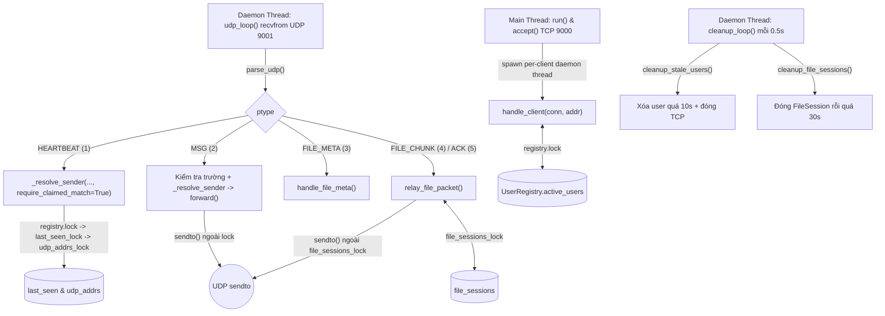
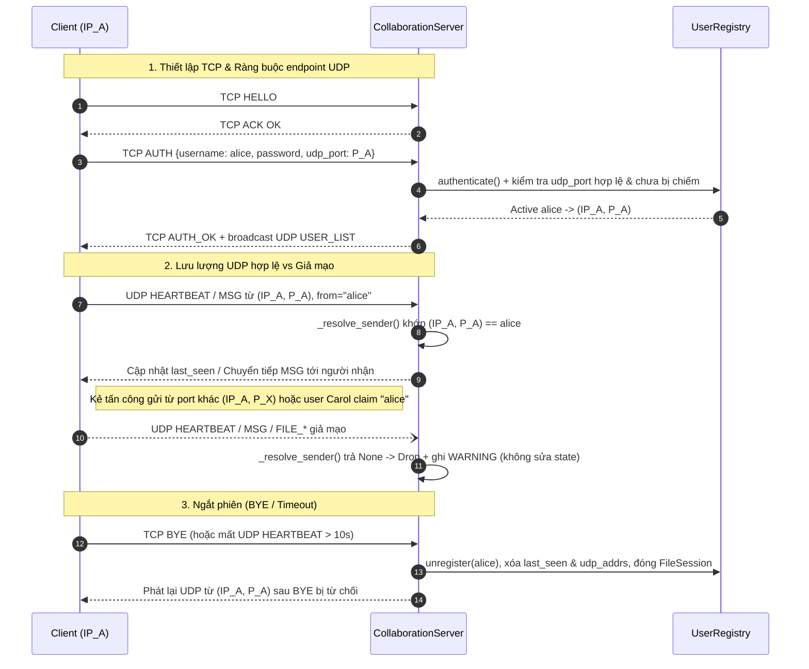

# Giải thích chi tiết `server.py` (`CollaborationServer`)

Tài liệu này mô tả kiến trúc nội bộ, trạng thái bộ nhớ, mô hình đa luồng, cơ chế định tuyến/relay và lớp bảo vệ UDP endpoint được triển khai trong [server.py](../server.py).

---

## 1. Tổng quan & Vai trò trong hệ thống

`server.py` đóng vai trò **máy chủ điều phối trung tâm** (TCP/UDP raw sockets, không dùng framework web), kết hợp với [registry.py](../registry.py) và [protocol.py](../protocol.py):

- **Kênh điều khiển TCP (cổng mặc định `9000`)**: Tiếp nhận kết nối từ client, xử lý `HELLO`, xác thực đăng nhập `AUTH`/`LOGIN`, trả danh sách người dùng `USER_LIST`, kiểm tra sống `PING`/`PONG` và ngắt phiên `BYE`/`LOGOUT`. Sử dụng length-prefix framing 4 byte (`!I`) + JSON UTF-8.
- **Kênh dữ liệu UDP (cổng mặc định `9001`)**: Nhận các datagram 37-byte header (kèm payload JSON mã hóa Fernet hoặc nhị phân thô), xác thực endpoint nguồn và xử lý `HEARTBEAT`, chuyển tiếp chat `MSG` (unicast/broadcast), đẩy thông báo `USER_LIST`, và relay truyền file (`FILE_META`, `FILE_CHUNK`, `ACK`).
- **Không lưu trữ mảnh file**: Server chỉ giữ bảng phiên ánh xạ địa chỉ hai đầu trong `FileSession`, chuyển tiếp datagram trực tiếp mà không đệm dữ liệu file lên RAM hay ổ đĩa.
- **Tên alias tương thích**: Cuối file khai báo `Server = CollaborationServer` (`server.py:934`) để giữ tương thích với các script gọi tên cũ.

> Nếu `port` được truyền khác `TCP_PORT` (9000) và không chỉ định `udp_port`, `CollaborationServer` tự chọn `udp_port = port + 1` (`server.py:88`).

---

## 2. Cấu trúc lớp & Trạng thái được quản lý

### 2.1 Lớp `FileSession` (`server.py:33-71`)

Mỗi phiên truyền file được định danh bởi UUID `msg_id` (`Packet.msg_id`) và lưu các thông tin điều tuyến tối thiểu:

| Thuộc tính / Property | Ý nghĩa |
| --- | --- |
| `msg_id` | UUID định danh phiên truyền file |
| `sender`, `sender_addr` | Username người gửi (`A`) và endpoint UDP `(ip, port)` của `A` |
| `receivers`, `receiver_addrs` | Danh sách người nhận (`B...`) và ánh xạ `username -> (ip, port)` |
| `broadcast`, `receiver` (`_label`) | `True` nếu `to == "*"` (`receiver == "*"`), ngược lại là tên người nhận unicast |
| `filename`, `size`, `chunks`, `checksum` | Metadata từ `FILE_META` để kiểm tra biên `chunk < total` và ghi log |
| `created`, `last_activity` | Dấu thời gian tạo phiên và gói tin hợp lệ gần nhất (phục vụ timeout 30s) |
| `to_receiver`, `to_sender` | Bộ đếm số datagram đã chuyển theo hai chiều `A -> B` và `B -> A` |
| `endpoints` | Property trả về `(sender_addr, receiver_addr)` phục vụ kiểm tra/log |

### 2.2 Các bảng trạng thái & Lock đồng bộ trong `CollaborationServer` (`server.py:74-120`)

Mỗi vùng dữ liệu dùng chung giữa các luồng đều có khóa riêng (`threading.Lock`) để tránh xung đột dữ liệu (race condition):

| Trạng thái | Khóa bảo vệ | Nội dung lưu trữ |
| --- | --- | --- |
| `self.registry` (`UserRegistry`) | `self.registry.lock` | Nguồn chân lý (source of truth) về user đang online: `username -> {username, ip, port, conn, login_time, udp_port?}` |
| `self.udp_addrs` | `self.udp_addrs_lock` | Cache endpoint UDP gần nhất đã xác thực: `username -> (ip, udp_port)` |
| `self.last_seen` | `self.last_seen_lock` | Thời điểm nhận tín hiệu sống hợp lệ gần nhất: `username -> float timestamp` |
| `self.file_sessions` | `self.file_sessions_lock` | Các phiên relay file đang mở: `msg_id (UUID) -> FileSession` |
| `self.log_file` | `self.log_lock` | Ghi nhật ký vận hành an toàn đa luồng ra file (mặc định `server.log`) |
| `self.seq_counter` (`SeqCounter`) | Lock nội bộ trong `protocol.py` | Sinh số `seq` tăng đơn điệu cho datagram do server phát ra (`USER_LIST`, `forward` dạng dict) |
| `self.running`, `self._stopped` | `self._stop_lock` | Điều phối tắt server một lần duy nhất (idempotent) |

---

## 3. Mô hình Đa luồng & Quy tắc tránh Deadlock

Khi gọi `run()` (`server.py:882-931`), server khởi tạo và vận hành đồng thời **3 loại luồng**:

1. **Main Thread (`run()`)**: Bind socket TCP/UDP, rồi chạy vòng `self.sock.accept()`. Mỗi kết nối TCP mới được giao cho một daemon thread riêng chạy `handle_client(conn, addr)` — nhờ đó một client chậm hoặc ngắt đột ngột không làm nghẽn các client khác.
2. **UDP Thread (`udp_loop()`)**: Một luồng daemon duy nhất liên tục gọi `self.udp_sock.recvfrom(65535)` trên cổng UDP, giải mã datagram và điều phối tới xử lý `HEARTBEAT`, `MSG`, `FILE_META`, `FILE_CHUNK`, `ACK`.
3. **Cleanup Thread (`cleanup_loop()`)**: Một luồng daemon chạy nền mỗi `0.5s` (`cleanup_interval`), gọi lần lượt `cleanup_stale_users()` và `cleanup_file_sessions()`. Khi ngủ giữa các chu kỳ, luồng dùng bước nhỏ `0.1s` để thoát ngay lập tức khi `self.running = False`.



**Nguyên tắc an toàn khóa (lock discipline):**
- Không giữ đồng thời hai lock theo thứ tự đối nghịch (`registry.lock`, `last_seen_lock`, `udp_addrs_lock` luôn được lấy tuần tự và giải phóng ngay sau khi đọc/ghi dict).
- Các lời gọi I/O mạng `self.udp_sock.sendto(...)` trong `forward()`, `_send_to_targets()`, `broadcast_user_list()` luôn thực hiện **sau khi đã thoát `file_sessions_lock` và `registry.lock`**, tránh chặn các luồng khác nếu hệ điều hành nghẽn bộ đệm gửi.

---

## 4. Luồng xử lý kênh điều khiển TCP (`handle_client`)

Hàm `handle_client(conn, addr)` (`server.py:683-842`) giữ `current_username = None` cho đến khi xác thực thành công, lặp đọc từng JSON frame qua `recv_json_frame(conn)`:

| Loại lệnh (`data["type"]`) | Hành vi xử lý | Phản hồi |
| --- | --- | --- |
| `HELLO` | Handshake tương thích Tuần 1 | `{"type": "ACK", "status": "OK"}` |
| `AUTH` / `LOGIN` | Chặn nếu `current_username` đã đăng nhập trên cùng socket; gọi `registry.authenticate()`, rồi `registry.register(username, client_ip, client_port, conn=conn, udp_port=udp_port)` | Thành công: `AUTH_OK` + danh sách `users`, cập nhật `last_seen` (và `udp_addrs` nếu có `udp_port`), log bảng user và `broadcast_user_list()`.<br>Thất bại: `AUTH_FAIL` kèm thông báo cụ thể |
| `USER_LIST` / `GET_USERS` | Lấy snapshot user online kèm IP/TCP port từ `registry.get_user_list()` | `{"type": "USER_LIST", "status": "OK", "users": [...]}` |
| `PING` | Kiểm tra kết nối TCP còn sống (phía client kiểm soát `CLIENT_TIMEOUT`) | `{"type": "PONG"}` |
| `BYE` / `LOGOUT` | Ngắt kết nối chủ động | Trả `{"type": "ACK", "status": "BYE"}` rồi thoát vòng lặp |

**Dọn dẹp trong khối `finally:` (`server.py:816-842`):**
Dù client gửi `BYE` hay ngắt đột ngột (`EOF` / `ConnectionResetError`), khối `finally:` luôn thực thi:
1. Gọi `self.registry.unregister(username=current_username)` (hoặc theo `addr` nếu chưa kịp `AUTH`).
2. Đóng toàn bộ phiên truyền file liên quan qua `self.close_sessions_for_user(current_username)`.
3. Xóa mục của user khỏi `self.last_seen` và `self.udp_addrs`.
4. Nếu user thực sự vừa rời khỏi trạng thái active (`was_active == True`): ghi log bảng Active Users mới và gọi `self.broadcast_user_list()` qua UDP tới những người còn lại.
5. Đóng TCP socket `conn`.

---

## 5. Bảo vệ UDP Endpoint & Xử lý gói tin UDP

Trước đây, máy chủ tin cậy `username` / `from` trong payload UDP hoặc tự động gắn địa chỉ UDP đến lần đầu (TOFU), tạo rủi ro giả mạo heartbeat/chat/endpoint. Phiên bản hiện tại ràng buộc chặt chẽ mọi lưu lượng UDP với phiên TCP đã `AUTH`:

### 5.1 Ràng buộc endpoint ngay lúc `AUTH`
1. **Lấy IP nguồn từ kết nối TCP đã chấp nhận (`accept()`)**: Server dùng chính `client_ip = addr[0]` từ socket TCP, không để client tự khai báo IP.
2. **Kiểm tra `udp_port` trong `UserRegistry.register()` (`registry.py:72-104`)**:
   - Trường `udp_port` vẫn tùy chọn (`None`) để các client thuần TCP (như một số bài test điều khiển TCP) đăng nhập bình thường; nhưng user không khai báo `udp_port` sẽ **không có endpoint UDP hợp lệ** và mọi gói UDP của user đó đều bị từ chối.
   - Nếu `udp_port` khác `None`: bắt buộc phải là kiểu `int`, không phải `bool` (`isinstance(True, int)` trong Python bị loại bỏ), và nằm trong dải `1 <= udp_port <= 65535`; sai trả về `INVALID_UDP_PORT` -> `AUTH_FAIL`.
   - Kiểm tra nguyên tử trong `self.registry.lock`: không cho phép user thứ hai đăng ký trùng cặp `(ip, udp_port)` đang thuộc về một user active khác (`UDP_ENDPOINT_IN_USE` -> `AUTH_FAIL`).

### 5.2 Xác thực người gửi trên mọi gói UDP
- **`get_user_udp_addr(username)` (`server.py:139-145`)**: Chỉ đọc từ `self.registry.active_users`; chỉ trả về `(info["ip"], int(info["udp_port"]))` khi user đang active **và** đã có `udp_port` từ `AUTH`. Không lấy port TCP thay thế.
- **`user_by_udp_addr(addr)` (`server.py:245-258`)**: Kiểm tra `addr` hợp lệ (`tuple` có port `int`, không phải `bool`) và tìm user active có `(info["ip"], int(info["udp_port"])) == (str(addr[0]), addr[1])`.
- **`_resolve_sender(addr, claimed_sender=None, require_claimed_match=False)` (`server.py:260-271`)**:
  - Chỉ ánh xạ qua `user_by_udp_addr(addr)` (loại bỏ hoàn toàn cơ chế TOFU tự nhận endpoint chưa ràng buộc).
  - Nếu `require_claimed_match=True`, bắt buộc tên khai báo trong payload (`username` hoặc `from`) phải là chuỗi khớp chính xác với user sở hữu endpoint nguồn `addr`.
  - Chỉ sau khi toàn bộ bước kiểm tra đạt yêu cầu mới cập nhật `self.last_seen[sender]` và `self.udp_addrs[sender]`.

### 5.3 Xử lý từng loại datagram trong `udp_loop()` (`server.py:570-681`)

Mỗi datagram nhận được đi qua `parse_udp(data)` (`protocol.py`) để kiểm tra header 37 byte, độ dài khớp payload, giải mã Fernet và kiểm tra bộ key bắt buộc (`REQUIRED_KEYS`). Gói hỏng bị bỏ qua ngay và ghi log.

1. **`HEARTBEAT` (`server.py:607-633`)**:
   - Kiểm tra `body` là `dict`, `username` là `str` không rỗng.
   - Gọi `_resolve_sender(addr, claimed_sender=username, require_claimed_match=True)`.
   - Nếu sai IP TCP, sai `udp_port`, user chưa login / không khai báo `udp_port`, hoặc user này giả mạo `username` của user khác: **từ chối và ghi `WARNING`**, không động vào `last_seen` hay `udp_addrs`.
2. **`MSG` (`server.py:636-675`)**:
   - Kiểm tra định dạng các trường trước khi xác thực: `from` (chuỗi không rỗng), `to` (chuỗi không rỗng), `text` (`1 <= len(text) <= MAX_TEXT_LEN`), và `time` (`int`/`float`, không phải `bool`, `math.isfinite(msg_time)` để chặn `NaN`/`Inf`).
   - Xác thực qua `_resolve_sender(addr, claimed_sender=claimed_from, require_claimed_match=True)`.
   - Chỉ khi tất cả hợp lệ mới gọi `self.forward(sender, packet)` (`server.py:147-235`):
     - Nếu `to == "*"`: gửi tới mọi user active khác trừ `sender`.
     - Nếu `to == "<username>"`: chỉ gửi cho đúng user đích nếu đang active và có địa chỉ UDP; user đích offline sẽ bị drop và ghi log.
     - Luôn đóng gói lại với `body["from"] = sender` để đảm bảo toàn vẹn định danh.
3. **Relay File (`FILE_META`, `FILE_CHUNK`, `ACK`) (`server.py:290-453`)**:
   - **`handle_file_meta()`**: Xác thực người gửi qua `_resolve_sender(addr)`. Kiểm tra người nhận đích hợp lệ, kiểm tra `_valid_file_meta()` (`filename` khác rỗng, `size >= 0`, `chunks >= 1`, `checksum` dài 64 ký tự). Tạo mới hoặc tái sử dụng `FileSession` theo `msg_id` (hỗ trợ retransmit khi mất ACK), ép `sender` thực tế vào `pack_file_meta(...)` và chuyển tiếp.
   - **`relay_file_packet()`**: Xác thực người gửi qua `_resolve_sender(addr)`, kiểm tra phiên `msg_id` tồn tại:
     - Chiều `A -> B` (`FILE_CHUNK`): chỉ chấp nhận khi `user == session.sender`, `packet.chunk < session.chunks`, và `packet.total == session.chunks`.
     - Chiều `B -> A` (`ACK`): chỉ chấp nhận khi `user in session.receivers`.
     - Đẩy datagram ngay qua `_send_to_targets()` (hỗ trợ gói đến lệch thứ tự và gửi trùng, không chặn Head-of-Line). Nếu gửi thất bại (`sent == 0` do peer rời), tự đóng phiên ngay.



---

## 6. Dọn dẹp Timeout & Dừng Server An toàn (`stop()`)

### 6.1 Quét timeout người dùng và phiên file (`server.py:483-569`)
- **`cleanup_stale_users()`**: Tìm các user có `now - last_seen[u] > self.client_timeout` (`10s` mặc định). Với mỗi user quá hạn: xóa khỏi `last_seen`, `udp_addrs`, gọi `registry.unregister()`, đóng `FileSession` qua `close_sessions_for_user()`, đóng TCP socket `conn` tương ứng, in lại bảng Active Users và phát `USER_LIST` mới cho các client còn lại.
- **`cleanup_file_sessions()`**: Đóng các `FileSession` không có datagram nào trong `file_session_timeout` (`30s` mặc định) và giải phóng bộ nhớ.

### 6.2 Ngắt socket sạch sẽ trong `stop()` / `close()` (`server.py:844-880`)
- Dùng `self._stop_lock` và cờ `self._stopped` để đảm bảo có thể gọi `stop()`/`close()` nhiều lần an toàn từ mọi luồng hoặc trong `finally:`.
- Đặt `self.running = False`, sau đó gọi **`shutdown(socket.SHUT_RDWR)` trước khi `close()`** trên:
  1. Socket TCP lắng nghe `self.sock`
  2. Socket UDP `self.udp_sock`
  3. Toàn bộ socket TCP `conn` của các client đang active
- Việc gọi `shutdown(SHUT_RDWR)` trước `close()` giúp đánh thức các luồng đang block ở `accept()`, `recv()`, `recvfrom()` ngay lập tức và giải phóng hoàn toàn port trên Linux (tránh lỗi `OSError: [Errno 98] Address already in use` khi khởi động lại server liên tiếp trên cùng cổng).
- Trong `udp_loop()` (`server.py:574-597`), vòng lặp kiểm tra `if not self.running: break` ngay sau khi `recvfrom` trả về hoặc ném lỗi khi socket đóng; đồng thời bắt riêng `ConnectionResetError` (Windows ICMP Port Unreachable khi client UDP đóng đột ngột) để tiếp tục phục vụ các client khác.

---

## 7. Khởi chạy & Kiểm thử liên quan

```bash
# Chạy server trực tiếp (lắng nghe TCP 9000, UDP 9001)
python server.py

# Chạy toàn bộ bộ kiểm thử (bao gồm bảo vệ endpoint, relay file, concurrency)
python -m pytest -v

# Chỉ chạy nhóm test cho server & bảo vệ endpoint UDP
python -m pytest tests/test_server.py tests/test_messaging.py tests/test_file_relay.py tests/test_endpoint_security.py -v
```

