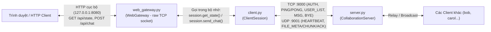
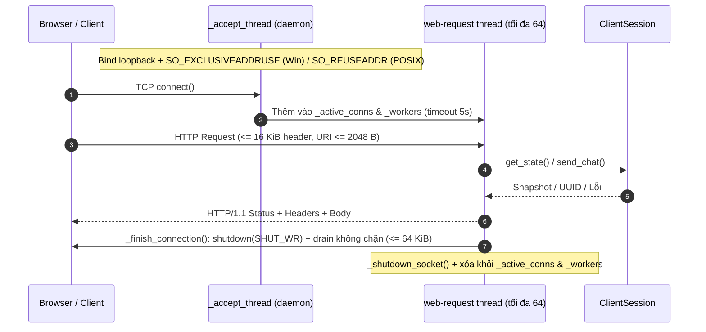

# Giải thích & Hướng dẫn sử dụng `web_gateway.py` (HTTP Gateway)

Tài liệu này mô tả vai trò, kiến trúc luồng dữ liệu, giao diện HTTP/JSON, các cơ chế bảo mật và cách chạy [web_gateway.py](../web_gateway.py) theo contract tại [docs/client_api.md](client_api.md).

---

## 1. Tổng quan & Vì sao gateway không gọi trực tiếp `server.py`

`web_gateway.py` chạy **bên trong tiến trình của từng client** trên địa chỉ loopback (`127.0.0.1`), làm cầu nối HTTP cục bộ giữa **Trình duyệt / Web UI** và phiên [`ClientSession`](../client.py#L47) đã đăng nhập:

- **Không kết nối trực tiếp tới `server.py`**: Mọi giao tiếp TCP/UDP với [`CollaborationServer`](../server.py#L74) (handshake `HELLO`, đăng nhập `AUTH` kèm `udp_port`, heartbeat `PING`/`PONG` + `HEARTBEAT`, nhận tin nhắn/file nền và mã hóa Fernet) đều do `ClientSession` sở hữu và duy trì từ trước.
- Nếu `web_gateway.py` tự mở kết nối riêng tới `server.py`, hệ thống sẽ bị đăng nhập trùng (`ALREADY_LOGGED_IN` / `UDP_ENDPOINT_IN_USE`), lộ mật khẩu/khóa mã hóa ra lớp HTTP hoặc làm nghẽn kênh điều khiển TCP.
- Vì vậy, `client.py` khởi tạo và xác thực `ClientSession` trước, rồi truyền **chính object `session` đó** vào [`start_gateway()`](../web_gateway.py#L561-L580):
  - `GET /api/state` gọi `session.get_state()` đọc bản sao trạng thái JSON đã được các luồng TCP/UDP nền cập nhật trong RAM (không phát gói TCP/UDP mới).
  - `POST /api/chat` gọi `session.send_chat(to, text)`, từ đó `ClientSession` gửi bản tin `MSG` (qua khung điều khiển TCP hoặc UDP datagram tương thích) tới `server.py` để chuyển tiếp sang người nhận.



> **Lưu ý về ràng buộc môn học (raw socket):** Toàn bộ máy chủ HTTP và bộ parser trong `web_gateway.py` được viết thuần bằng `socket` TCP + `threading` chuẩn của Python (không dùng Streamlit, Flask, Django hay `http.server`), phù hợp nguyên tắc raw socket tại [README.md](../README.md#L3). Cờ `--web-port` hiện để ở chế độ tùy chọn (opt-in), chưa bật mặc định trong `client.py` để nhóm đối chiếu thêm phản hồi của giảng viên về phạm vi Web UI.

---

## 2. Cách sử dụng thực tế

### 2.1 Chạy trực tiếp qua CLI (`client.py --web-port`)

Mở **3 cửa sổ PowerShell** tại thư mục gốc của dự án:

**1. Khởi chạy Server:**
```powershell
python server.py
```

**2. Khởi chạy Alice kèm HTTP gateway cổng `8080`:**
```powershell
python client.py alice pass123 --web-port 8080
```

**3. Khởi chạy Bob kèm HTTP gateway cổng `8081` (hoặc bỏ `--web-port` nếu chỉ dùng CLI):**
```powershell
python client.py bob pass123 --web-port 8081
```

**4. Khởi chạy Web UI thuần túy (Web-First Mode - Đăng nhập trực tiếp trên Web UI):**
```powershell
python client.py --web-port 8080 --web-only
```
Sau đó mở trình duyệt tại `http://127.0.0.1:8080` để thấy form Đăng nhập, nhập username/password và trải nghiệm toàn bộ tính năng.

**Thử nghiệm API HTTP của Alice từ một terminal khác (hoặc trình duyệt / Postman):**
```powershell
# Đọc snapshot trạng thái hiện tại (users online, messages, transfers)
Invoke-RestMethod -Uri "http://127.0.0.1:8080/api/state" | ConvertTo-Json -Depth 5

# Gửi tin nhắn qua HTTP -> UDP -> server.py -> Bob
Invoke-RestMethod -Method Post -Uri "http://127.0.0.1:8080/api/chat" `
  -ContentType "application/json" `
  -Body '{"to":"bob","text":"Xin chào Bob từ HTTP gateway!"}'

# Xem dữ liệu mock UI ở gốc repo
Invoke-RestMethod -Uri "http://127.0.0.1:8080/mock_state.json" | ConvertTo-Json -Depth 5
```

> Nếu trong repo chưa có thư mục `static/` hoặc `ui/` (phần giao diện HTML/JS), truy cập `GET http://127.0.0.1:8080/` sẽ trả về `404 {"error":"Not found"}`, còn `/api/state`, `/api/chat` và `/mock_state.json` vẫn hoạt động bình thường. Khi có thư mục `static/` (hoặc `ui/`) chứa `index.html`, gateway tự nhận diện và phục vụ luôn giao diện web.

### 2.2 Nhúng bằng Python API (`start_gateway`)

Hàm `start_gateway()` trong [web_gateway.py](../web_gateway.py#L561-L580) bind socket đồng bộ rồi trả về handle [`WebGateway`](../web_gateway.py#L222) ngay lập tức để không chặn luồng gọi:

```python
from client import ClientSession
from web_gateway import start_gateway

session = ClientSession("alice", "pass123", host="127.0.0.1", port=9000, server_udp_port=9001)
if not session.start():
    raise RuntimeError(session.get_state()["status"]["detail"])

gateway = start_gateway(session, host="127.0.0.1", port=8080)
try:
    print("HTTP Gateway đang chạy tại:", gateway.url)
    session.wait()
finally:
    gateway.close()  # Luôn đóng gateway trước khi đóng session
    session.close()
```

Tham số của `start_gateway()`:
- `session`: Bất kỳ đối tượng nào thỏa protocol [`SessionAPI`](../web_gateway.py#L43-L52) (có phương thức `get_state()` và `send_chat(to, text)`).
- `host` (mặc định `"127.0.0.1"`): Chỉ chấp nhận `"localhost"` hoặc địa chỉ IPv4 loopback (`127.0.0.0/8`); mọi địa chỉ ngoài loopback (như `"0.0.0.0"`, IP LAN) đều bị từ chối với `ValueError`.
- `port` (mặc định `8080`): Số cổng `0..65535` (truyền `0` để hệ điều hành cấp cổng trống).
- `static_dir` (mặc định `None`): Đường dẫn thư mục giao diện tĩnh (không được trỏ tới gốc repo hay thư mục cha). Nếu để `None`, gateway tự kiểm tra lần lượt `<repo>/static` rồi `<repo>/ui`.
- `max_body_bytes` (mặc định `16384`): Giới hạn kích thước payload HTTP (byte).

Tích hợp trong [`client._run_client_impl()`](../client.py#L434-L501): nếu truyền `--web-port`, CLI chỉ gọi `start_gateway()` sau khi `session.start()` xác thực thành công; nếu bind cổng HTTP thất bại (`OSError`), ngoại lệ lan ra khối `finally:` để đóng luôn `ClientSession` sạch sẽ.

---

## 3. Hợp đồng API HTTP & Bảng mã lỗi (`_dispatch`)

Mọi phản hồi JSON đều đính kèm các header chuẩn:
- `Content-Type: application/json; charset=utf-8`
- `Content-Length: <n>`
- `Connection: close`
- `X-Content-Type-Options: nosniff`
- `Cache-Control: no-store`
- **Không bật wildcard CORS (`Access-Control-Allow-Origin: *`)**: Trình duyệt tải UI và gọi API trên cùng origin loopback, ngăn trang web lạ từ tab khác đọc trộm trạng thái chat nội bộ (CSRF / cross-origin leak).

| Endpoint & Method | Hành vi xử lý | Mã phản hồi & Body |
| --- | --- | --- |
| `GET /api/state` | Trả về snapshot Schema v1 UTF-8. Nếu chưa đăng nhập, trả về snapshot mặc định trạng thái `disconnected`. | `200 OK` + JSON snapshot;<br>`503` nếu session lỗi transport |
| `POST /api/login` | Đăng nhập tài khoản động (`{"username": "...", "password": "..."}`). Tạo và khởi chạy `ClientSession`. | `200 OK` + `{"status": "ok", "state": ...}`;<br>`400` nếu thiếu trường;<br>`401 Unauthorized` nếu sai tài khoản |
| `POST /api/logout` | Đóng phiên làm việc hiện tại, đưa gateway về trạng thái chờ đăng nhập. | `200 OK` + `{"status": "ok", "state": ...}` |
| `POST /api/chat` | Gửi tin nhắn (`{"to": "...", "text": "..."}`). Bắt buộc đã đăng nhập. | `202 Accepted` + `{"message_id": "<UUID>"}`;<br>`401` nếu chưa login;<br>`400` nếu payload sai;<br>`503` nếu lỗi kết nối |
| `POST /api/file/send` | Gửi file từ đường dẫn cục bộ máy chủ (`{"to": "...", "path": "..."}`). | `202 Accepted` + `{"transfer_id": "<UUID>"}`;<br>`400` nếu file không tồn tại |
| `POST /api/file/upload` | Nhận upload tệp từ browser qua Base64 (`{"to": "...", "filename": "...", "content": "<b64>"}`), lưu vào `uploads/` và gửi. Hỗ trợ tệp đến 50 MiB. | `202 Accepted` + `{"transfer_id": "...", "filename": "..."}` |
| `GET /api/file/download/<file>` hoặc `?filename=...` | Cho phép tải về tệp tin đã nhận hoàn tất từ thư mục `downloads/` kèm header `Content-Disposition: attachment`. Chặn path traversal. | `200 OK` + file binary bytes;<br>`400` nếu tên file không an toàn;<br>`404` nếu tệp không tồn tại |
| `GET /api/transfers` | Trả về danh sách trạng thái truyền/nhận file và thông số kiểm soát nghẽn CUBIC (`cwnd`, `rto`, `progress`). | `200 OK` + `{"transfers": [...]}` |
| `GET /api/events` | Luồng **Server-Sent Events (SSE)** đẩy cập nhật Real-time (0ms trễ) mỗi khi có tin nhắn, user online/offline hoặc tiến độ tệp thay đổi. | `200 OK` + `Content-Type: text/event-stream` (luồng dữ liệu liên tục) |
| `GET /mock_state.json` | Đọc tệp `mock_state.json` tại gốc repo phục vụ UI thử nghiệm | `200 OK` + nội dung JSON;<br>`404` nếu tệp không tồn tại |
| `GET /` hoặc tài nguyên tĩnh | Ánh xạ `/` -> `index.html` trong thư mục static/ui; kiểm tra allowlist phần mở rộng và giới hạn `2 MiB` | `200 OK` + MIME type tương ứng;<br>`413` nếu vượt `MAX_STATIC_BYTES`;<br>`404` cho đường dẫn sai |
| Sai method trên route hợp lệ | Trả lỗi method và quảng bá phương thức hợp lệ | `405 Method Not Allowed` + header `Allow: ...` |

---

## 4. Kiến trúc Đa luồng, Socket & Bảo mật HTTP Parser

### 4.1 Vòng đời kết nối & Dọn dẹp (`WebGateway`)



- **Kiểm soát đồng thời & Anti-DoS**:
  - Số kết nối xử lý đồng thời bị chặn trần bởi `MAX_CONNECTIONS = 64` ([`web_gateway.py#L18`](../web_gateway.py#L18)); kết nối vượt ngưỡng bị đóng ngay khi `accept()` để không bùng nổ luồng.
  - Mỗi socket kết nối có `settimeout(5.0)` chống giữ kết nối rỗi (slow-loris); quá hạn trả `400 {"error": "Request timed out"}`.
- **Xử lý socket chuẩn trên Windows & Linux**:
  - Trên Windows dùng `SO_EXCLUSIVEADDRUSE` (trên POSIX dùng `SO_REUSEADDR`) giúp bắt buộc ném `OSError` nếu hai client mở trùng `--web-port` trên Windows thay vì chiếm cổng âm thầm, đồng thời cho phép mở lại đúng cổng ngay sau `gateway.close()`.
  - [`_finish_connection()`](../web_gateway.py#L386-L401) thực hiện nửa-đóng (`shutdown(SHUT_WR)`) rồi rút tối đa `64 KiB` byte đã nằm sẵn trong buffer (`settimeout(0.0)`) trước khi `close()` theo RFC 9112 mục 9.6 — nhờ đó client nhận trọn vẹn các gói lỗi cắt sớm (`413`, `414`, `431`) và `EOF` sạch thay vì gặp TCP `RST` (`ConnectionResetError`).
  - Hàm `close()` khóa qua `self._lock`, đặt `_stopped`, gọi `_shutdown_socket` trên listener lẫn mọi client socket đang chạy và `join()` ngắn các luồng worker (hỗ trợ gọi lặp lại an toàn).

### 4.2 Các lớp phòng vệ trong HTTP Parser & Static Serving

1. **Giới hạn Request Framing ([`_read_request`](../web_gateway.py#L127-L219))**:
   - Giới hạn chiều dài target/URI `MAX_URI_LEN = 2048` (`414`) ngay trong lúc nhận chunk đầu tiên, trước cả khi kết thúc header `\r\n\r\n`.
   - Giới hạn tổng header `MAX_HEADER_BYTES = 16384` (`431`) và kích thước body `max_body_bytes` (mặc định `16384` byte -> `413`), so sánh độ dài chuỗi thập phân trước khi ép kiểu `int` để tránh DoS số nguyên lớn.
   - Từ chối `Transfer-Encoding` (chống request smuggling), từ chối nhiều `Content-Length` khác giá trị hoặc chứa ký tự không phải chữ số (`400`), từ chối nhiều `Content-Type` xung đột (`400`), chặn request target `//...` và header chứa ký tự điều khiển / line-folding.
   - Giữ lại đúng phần byte body nếu client gửi dính chung cùng gói tin với dấu kết thúc header `\r\n\r\n`.
   - Khi parse JSON chat, truyền `parse_constant=_reject_json_constant` để loại `NaN`, `Infinity`, `-Infinity`.
2. **Bảo vệ Static Paths ([`_static_target`](../web_gateway.py#L524-L558) & [`_resolve_static_root`](../web_gateway.py#L101-L116))**:
   - Không bao giờ lấy gốc repo hay thư mục cha làm `static_dir` (ngăn lộ `users.json`, `config.py`, `server.py`, `.git`).
   - Từ chối đường dẫn chứa null byte (`\x00`), dấu gạch chéo ngược (`\` / `%5c`), dấu hai chấm (`:` — chặn ổ đĩa Windows `C:` và NTFS Alternate Data Stream `::$DATA`), segment bắt đầu bằng dấu chấm (`.env`, `.git`, `..`, `%2e%2e`).
   - Giải mã URL một lần (không double-decode), gọi `.resolve()` và bắt buộc `target.relative_to(root)` nhằm chặn symlink trỏ thoát ra ngoài thư mục tĩnh.
   - Chỉ phục vụ các tệp thuộc `_ALLOWED_EXTENSIONS` (`.html`, `.htm`, `.css`, `.js`, `.mjs`, `.json`, `.png`, `.jpg`, `.jpeg`, `.gif`, `.svg`, `.ico`, `.txt`, `.woff2`) và kích thước tối đa `MAX_STATIC_BYTES = 2 MiB`.

---

## 5. Kiểm thử liên quan ([`tests/test_web_gateway.py`](../tests/test_web_gateway.py))

Bộ kiểm thử gồm hai nhóm chính:
1. **Unit & Security Tests** (dùng `FakeSession` và socket thô để kiểm tra hàng loạt biên lỗi trong vài giây): kiểm tra validation tham số khởi tạo, va chạm/nhả cổng, toàn bộ mã HTTP (`200`, `202`, `400`, `404`, `405`, `413`, `414`, `431`, `503`), gửi tách mảnh TCP, 20 request đồng thời, đóng kết nối rỗi khi shutdown, tự nhận diện `static/`/`ui/`, và chặn toàn bộ payload path traversal / ADS / dotfile / symlink escape.
2. **End-to-End Integration Tests với `CollaborationServer` + `ClientSession`** ([dòng 1109–1351](../tests/test_web_gateway.py#L1109-L1351)):
   - `test_real_server_http_chat`: khởi chạy server + `alice` + `bob` thật, gửi `POST /api/chat` (unicast, broadcast `*`, và payload rỗng bị `400`) qua HTTP và xác nhận `bob` nhận được gói UDP qua server.
   - `test_run_client_gateway_lifecycle` & `test_run_client_gateway_collision_cleanup`: kiểm thử trực tiếp luồng `client._run_client_impl(..., web_port=...)` cả khi chạy bình thường lẫn khi kẹt cổng HTTP để đảm bảo `ClientSession` tự đăng xuất sạch sẽ.

Chạy kiểm thử riêng cho gateway hoặc toàn bộ dự án:
```bash
# Chạy riêng bộ test của HTTP gateway
python -m pytest tests/test_web_gateway.py -v

# Chạy toàn bộ bộ kiểm thử dự án (208 passed, 1 skipped trên Windows; 209 passed trên Linux WSL)
python -m pytest -v
```

